<p align="center">
  
</p>

<h1 align="center">ORBITX · MARS SENTINEL — Complete Technical & Visual Documentation</h1>

<p align="center">
  <strong>Comprehensive Multi-Engine Engineering Manual, Simulation Physics Reference & Full Visual Atlas</strong><br />
  <em>2026 NASA Space Apps Challenge · Team ORBITX (<code>orbitX00</code>) · Jezero Crater, Mars (<code>18.4447°N, 77.4508°E</code>)</em>
</p>

---

## Table of Contents

1. [Executive Overview & End-to-End Multi-Engine Architecture](#1-executive-overview--end-to-end-multi-engine-architecture)
2. [Chapter 1 — NASA Scientific Data Pipeline, HiRISE Photogrammetry & USGS Geology (6 Figures)](#chapter-1--nasa-scientific-data-pipeline-hirise-photogrammetry--usgs-geology)
3. [Chapter 2 — Authentic NASA Perseverance Field Outcrops & Astrobiology Targets (6 Figures)](#chapter-2--authentic-nasa-perseverance-field-outcrops--astrobiology-targets)
4. [Chapter 3 — Module 1: Blender 5.2 Orbital Astrodynamics & 3D Production Master (9 Figures)](#chapter-3--module-1-blender-52-orbital-astrodynamics--3d-production-master)
5. [Chapter 4 — Module 2: Interactive WebGL 3D Digital Twin & "Google Earth for Mars" (3 Figures)](#chapter-4--module-2-interactive-webgl-3d-digital-twin--google-earth-for-mars)
6. [Chapter 5 — Module 3: Autonomous CTX A* Pathfinding, Solar Optics & RF Viewshed (`nav-module`) (1 Figure)](#chapter-5--module-3-autonomous-ctx-a-pathfinding-solar-optics--rf-viewshed-nav-module)
7. [Chapter 6 — Module 4: Unity 6 (`6000.6.9f1`) Playable 0.38g Survival Game & Subsurface Radar (2 Figures)](#chapter-6--module-4-unity-6-600069f1-playable-038g-survival-game--subsurface-radar)
8. [Chapter 7 — Module 5: Unreal Engine 5.8 DX12 Lumen GI & Nanite Planetary Simulation (1 Figure)](#chapter-7--module-5-unreal-engine-58-dx12-lumen-gi--nanite-planetary-simulation)
9. [Chapter 8 — Authentic NASA 3D Spacecraft & Rover Fleet Catalog (7 Figures)](#chapter-8--authentic-nasa-3d-spacecraft--rover-fleet-catalog)
10. [Chapter 9 — Unified 5-Chapter Interactive Story Campaign ("Sol 1042: Echoes of Jezero")](#chapter-9--unified-5-chapter-interactive-story-campaign-sol-1042-echoes-of-jezero)
11. [Chapter 10 — Module 6: Automated Verification, Cryptographic Invariants & Quick-Start Guide](#chapter-10--module-6-automated-verification-cryptographic-invariants--quick-start-guide)

---

## 1. Executive Overview & End-to-End Multi-Engine Architecture

**ORBITX: Mars Sentinel** is a multi-engine planetary survival, astrodynamics, autonomous EVA pathfinding, and 3D geospatial simulation ecosystem anchored to the **Octavia E. Butler Landing Site** in **Jezero Crater, Mars** (`18.4447°N, 77.4508°E`, elevation `-2,569 m` MOLA).

Rather than building a single isolated prototype, **Team ORBITX** engineered **six synchronized modules** that all consume the exact same verified NASA/USGS Digital Terrain Models, orbital ephemeris parameters, and route telemetry:

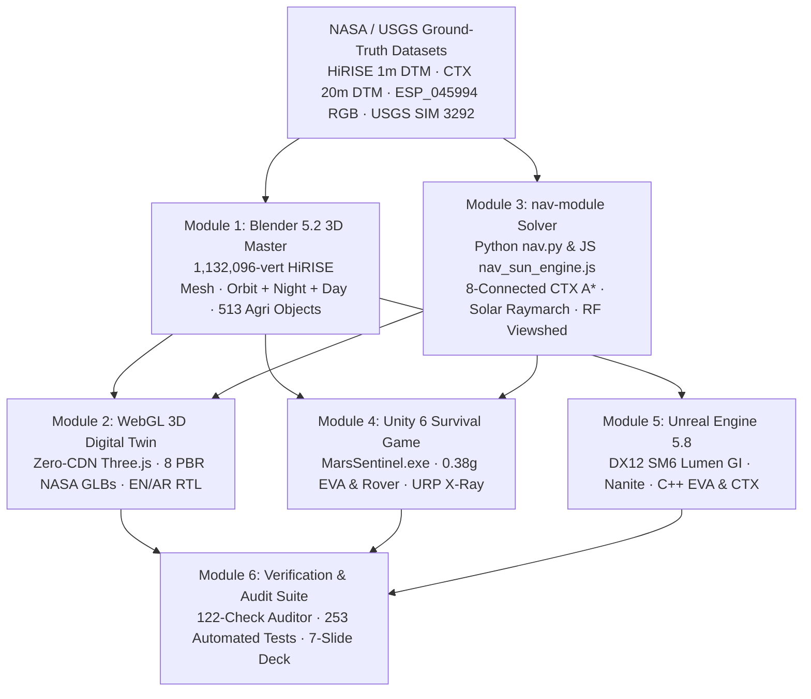

### Core Engineering Pillars
- **Zero Synthetic Topography:** Every elevation vertex, slope gradient, and shadow ray is computed from authoritative USGS Astrogeology MRO HiRISE (`DOI 10.5066/P9REJ9JN`) and CTX (`DOI 10.5066/P906QQT8`) GeoTIFF rasters.
- **Cryptographic Data Trust Layer:** The master 4 m HiRISE mesh (`NASA_HiRISE_DTM_Jezero_FieldSite_4m`) is continuously verified against its exact vertex count (`1,132,096`) and coordinate buffer hash (`SHA-256: ed5e2c9e0d23cb45dfbaf7c11deee3e168ea59d9681d8a094e3b514b32b354dd`).
- **Offline-First & Zero-CDN Execution:** Every web library (`Three.js`, `GLTFLoader`), 3D GLB model, dataset, and executable runs completely locally without external CDN dependencies.
- **Full Bilingual Accessibility (`EN` / `AR RTL`):** Mission telemetry, story chapters, planetary bookmarks, and survival HUDs support both English and native Arabic Right-to-Left (`العربية`).

---

## Chapter 1 — NASA Scientific Data Pipeline, HiRISE Photogrammetry & USGS Geology

Before building any 3D environment or game engine scene, we constructed a reproducible Python geospatial ingestion pipeline (`data/build_hirise_site_detail.py`, `data/build_terrain_grid.py`, `tools/build_jezero_surface_color.py`, and `tools/build_local_mars_color.py`) to transform raw orbital spacecraft observations into calibrated 3D displacement and true-color surface textures.

### Figure 1.1 — MRO HiRISE Merged RGB Orbital Strip (`ESP_045994_1985_MRGB`)

- **Source Product:** NASA Mars Reconnaissance Orbiter (MRO) HiRISE Observation `ESP_045994_1985_MRGB` (`data/ESP_045994_1985_MRGB.browse.jpg` & `ESP_045994_1985_MRGB.JP2`).
- **Explanation:** This high-resolution orbital color strip captures the central western Jezero Crater delta where NASA's Perseverance rover landed. Standard orbital cameras often output monochrome red-channel imagery or false-color infrared (IRB); this Merged RGB swath supplies authentic mineralogical color across the central `41%` of our `4,096 m × 4,096 m` field site, revealing dark basaltic dunes, bright carbonate-bearing delta margins, and ancient river channels.

### Figure 1.2 — 4-Meter HiRISE Digital Elevation Heightmap (`jez_hirise_site_height_4m.png`)

- **Source Product:** Derived from USGS HiRISE 1 m DTM `data/JEZ_hirise_soc_006_DTM_1m.tif` (`DOI 10.5066/P9REJ9JN`).
- **Explanation:** A `1024 × 1024` normalized metric elevation raster covering `4,096 m × 4,096 m` around Octavia E. Butler Landing Site (`18.42875°N, 77.44215°E`). Brighter pixels encode higher elevations along the western Jezero delta scarp and remnant mesas (such as *Kodiak* and *Belva Crater* rim), while darker regions trace the lower crater floor. This exact heightmap drives the 3D terrain mesh displacement in Blender 5.2, Unity 6, Unreal Engine 5.8, and WebGL.

### Figure 1.3 — 1-Meter HiRISE Red-Filter Albedo Map (`jez_hirise_site_hirise_red_1m.png`)

- **Source Product:** HiRISE RED-band ortho-mosaic (`JEZ_hirise_soc_006_orthoMosaic_25cm`, `DOI 10.5066/P9QJDP48`).
- **Explanation:** Captures micro-scale surface reflectance, boulder fields, crater ejecta rays, and aeolian sand ripples across the entire `4,096 m` field window. Because the RED band covers 100% of the field site (whereas the color swath covers the central strip), it acts as the high-frequency luminance backbone for our surface texturing pipeline.

### Figure 1.4 — Local Calibrated Surface RGB Texture (`jez_hirise_site_local_rgb_1m.png`)

- **Pipeline Script:** `tools/build_local_mars_color.py`.
- **Explanation:** Intermediate color-calibrated map aligning the HiRISE Merged RGB strip to the 4 m elevation grid coordinates, normalizing exposure seams and removing orbital sensor edge artifacts prior to full-window fusion.

### Figure 1.5 — Final Fused NASA True-Color Surface Map (`jez_hirise_site_nasa_color_1m.png`)

- **Pipeline Script:** `tools/build_jezero_surface_color.py`.
- **Explanation:** Our authoritative surface color texture applied across Blender 5.2, Unity 6, and Unreal Engine 5.8. Where the HiRISE MRGB swath exists (central `41%`), true HiRISE RGB is preserved; across the outer margins, HiRISE RED luminance is physically modulated with Viking MDIM 2.1 global Mars chromaticity using a `30 m` smooth feather transition so there are zero artificial seams:
  $$\text{RGB}_{\text{outer}} = \text{clip}\left(\frac{\text{HiRISE\_RED}}{255} \times \frac{\overline{\text{Viking\_RGB}}}{\text{Viking\_Luma}}\right)$$

### Figure 1.6 — USGS SIM 3292 Geological Stratigraphy Slice (`sample_geology_slice.png`)
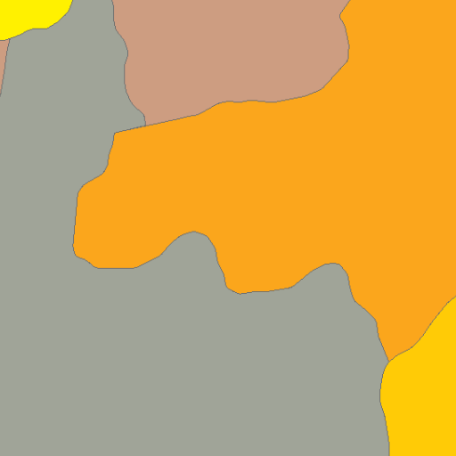
- **Source Dataset:** USGS Scientific Investigations Map 3292 (`data/geology/usgs_sim3292_stratigraphy.json` & `usgs_sim3292_units.json`).
- **Explanation:** Maps the geological units of Jezero Crater — distinguishing Noachian basement crust (`Nbh`), olivine-carbonate crater floor units (`Cf-fr` / *Séítah* and *Máaz* formations), and Hesperian/Noachian lacustrine delta deposits (`HNd`). This geological classification directly powers the **Omni-Probe PIXL & RIMFAX Subsurface Scanner** in our WebGL Digital Twin and the **Science Route (`1,203.21 m`)** waypoints.

---

## Chapter 2 — Authentic NASA Perseverance Field Outcrops & Astrobiology Targets

To ground our mission story and rover science objectives in real Martian discoveries, we integrated actual NASA/JPL-Caltech Mastcam-Z and WATSON photographs and metadata (`data/imagery/outcrops/outcrops_imagery_index.json`) directly into both our WebGL Geology panel and Unity 6 `StreamingAssets/NASA_Data/`.

### Figure 2.1 — NASA Perseverance Mastcam-Z Field Panorama (`perseverance_sample_raw.jpg`)

- **Explanation:** Raw field image captured by the Perseverance rover inside Jezero Crater (`data/imagery/perseverance_sample_metadata.json`), used as a ground-truth color and regolith lighting reference to calibrate our 3D Martian sand shaders, basalt boulder roughness, and atmospheric dust haze across Blender, WebGL, Unity, and Unreal Engine 5.8.

### Figure 2.2 — Rochette Outcrop (`rochette_sol194.jpg` · Sol 194)
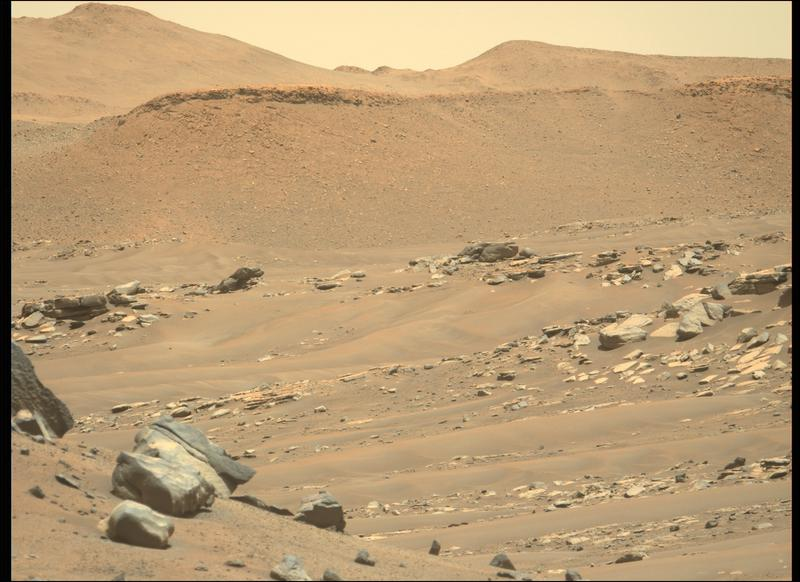
- **Mission Role:** Waypoint 1 along `MS_Route_Science_HiRISE` (`1,203.21 m`).
- **Explanation:** Located on the *Artuby* ridge of the *Máaz* formation, *Rochette* was the first Martian rock successfully cored and sealed by Perseverance (samples *Montdenier* and *Montagnac*). Its basaltic composition with sulfate salt veins revealed prolonged groundwater interaction inside Jezero Crater.

### Figure 2.3 — Wildcat Ridge (`wildcat_ridge_sol509.jpg` · Sol 509)
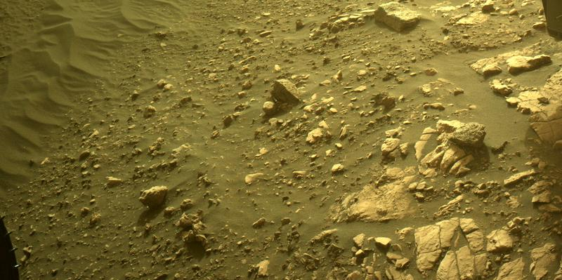
- **Mission Role:** Sedimentary delta-front astrobiology target in the WebGL Geology & Omni-Probe inspector.
- **Explanation:** A `1 m`-wide fine-grained mudstone slab deposited at the bottom of ancient Lake Jezero ~3.5 billion years ago. Perseverance's SHERLOC spectrometer detected the highest concentration of aromatic organic molecules found during the delta-front campaign here.

### Figure 2.4 — Berea Outcrop (`berea_sol749.jpg` · Sol 749)
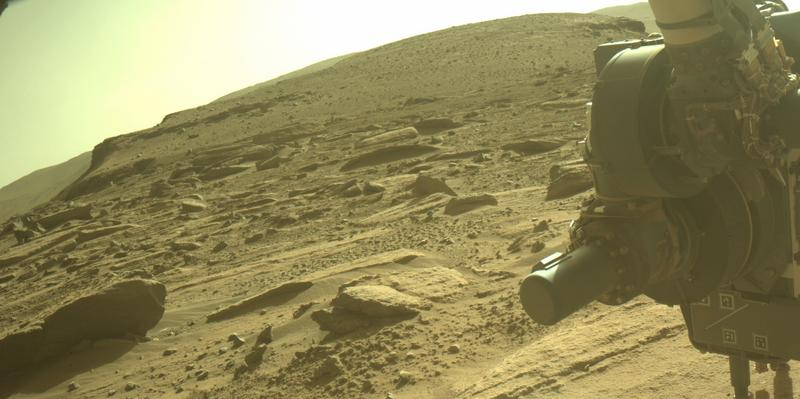
- **Mission Role:** Upper-fan fluvial carbonate sampling station.
- **Explanation:** Carbonate-rich sandstone deposited by a fast-moving ancient river flowing into Jezero Crater. Carbonates are critical climate capsules that preserve evidence of ancient Martian atmospheric CO₂ levels and liquid water chemistry.

### Figure 2.5 — Cheyava Falls (`cheyava_falls_sol1215.jpg` · Sol 1215)
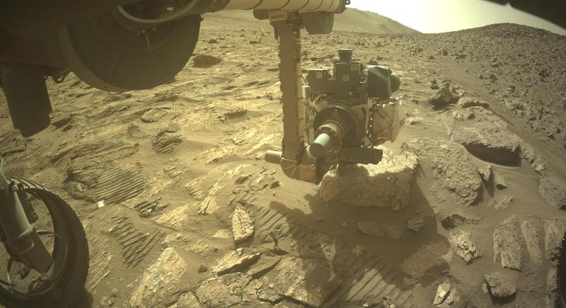
- **Mission Role:** Focal scientific target of **Chapter 2 (*Cheyava Falls Biosignature*)** across WebGL, Unity 6, and Unreal Engine 5.8.
- **Explanation:** Discovered in *Neretva Vallis*, *Cheyava Falls* is an arrowhead-shaped reddish mudstone veined with white calcium sulfate and dotted with millimeter-scale "leopard spots" ringed in iron phosphate and iron sulfide — chemical reaction fronts closely associated on Earth with ancient microbial energy metabolism.

### Figure 2.6 — Witch Hazel Hill (`witch_hazel_hill_sol1401.jpg` · Sol 1401)
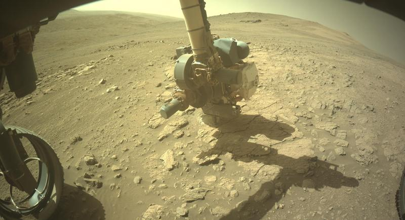
- **Mission Role:** High-elevation crater-rim reconnaissance target for long-range CTX A\* planning.
- **Explanation:** Light-toned, layered bedrock exposed high on the western Jezero Crater rim, representing some of the oldest (>3.9 billion year) Noachian crustal rocks excavated during the original Jezero impact event.

---

## Chapter 3 — Module 1: Blender 5.2 Orbital Astrodynamics & 3D Production Master

**Primary Files:** `MARS_SENTINEL_HERO_PRODUCTION.blend`, `tools/mars_front_view.py`, `tools/blender_mcp_server.py`, `scripts/render_blender_hero_night_and_orbit.py`.

Our Blender 5.2 production master is the geometric and visual single source of truth for the entire ecosystem. It contains `2,274` verified mesh datablocks, `18` structured Outliner collections, `0` external linked library dependencies, and the locked `1,132,096`-vertex 4 m HiRISE terrain mesh.

### Figure 3.1 — Live Blender 5.2 Outer-Space Mars, Orbital Rings & Sun Simulation (`Key 2`)
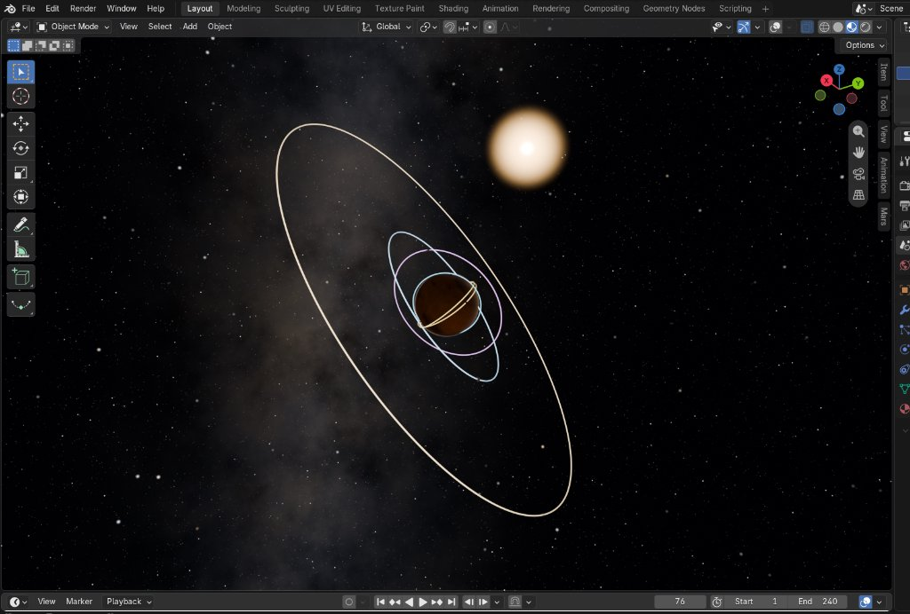
- **Explanation:** Direct 3D viewport simulation inside Blender 5.2 showing Planet Mars suspended against the Milky Way starfield, surrounded by inclined 3D Keplerian orbital trajectories for **Phobos** (`9,376 km`), **Deimos** (`23,463 km`), **MRO**, **MAVEN**, and **Mars Odyssey**, illuminated by the Sun. Pressing **`Key 2`** in `tools/mars_front_view.py` transitions smoothly into this orbital view.

### Figure 3.2 — Rendered 1920×1080 Outer-Space Planetary & Solar Astrodynamics (`Key 2`)
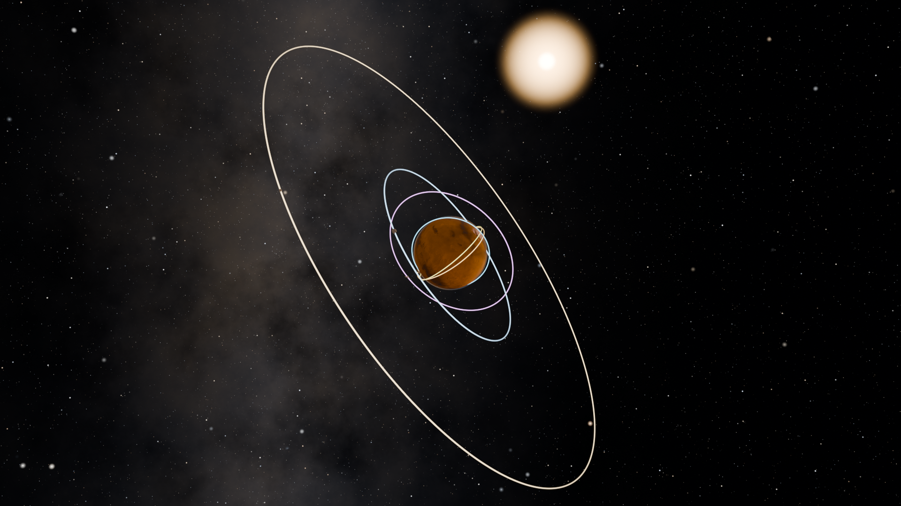
- **Explanation:** High-resolution production render (`MARS_NEW_Globe_Camera`) highlighting Mars's sunlit dust-red hemisphere, terminator falloff, delicate blue-amber atmospheric scattering limb, orbital relay paths, and solar light source.

### Figure 3.3 — Canonical Planetary Globe & Milky Way Starfield Preview (`previews/final_key2_planet_starfield.png`)
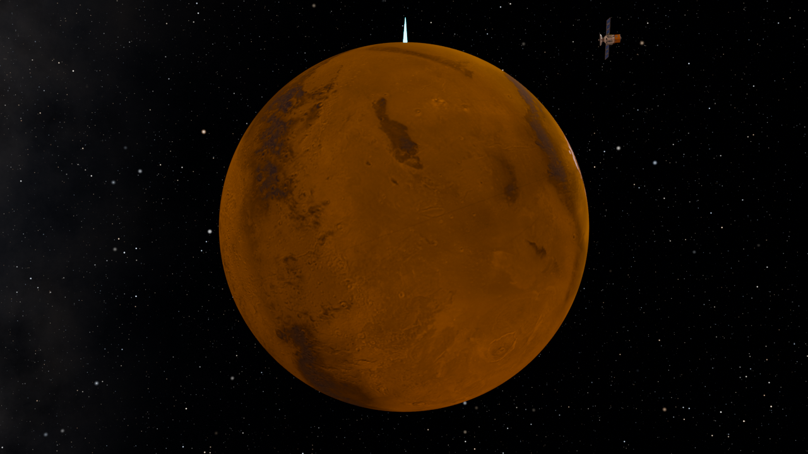
- **Explanation:** Baseline orbital verification render used by both the WebGL Provenance viewer and the automated integrity suite (`test_f08_final_key2_planet_starfield_preserved`), demonstrating Mars's axial tilt (`25.19°`) and Jezero Crater surface beacon.

### Figure 3.4 — Live Blender 5.2 Nocturnal Surface & Dual-Moon Simulation (`Key 5`)
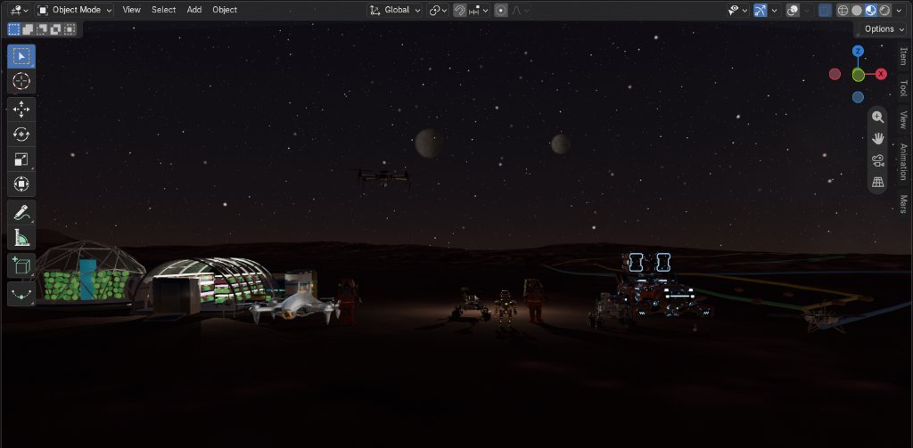
- **Explanation:** Direct nocturnal 3D viewport simulation from the Jezero Crater surface looking across the illuminated base camp toward **Phobos and Deimos** hanging side-by-side in the starry Martian night sky. From left to right: the Geodesic Aeroponics Dome (`MS_GH2`), Vaulted Hydroponics Greenhouse (`MS_GH1`), White VTOL Recon Drone, EVA Astronauts, Hovering Quadrotor Drone, Perseverance Rover, Heavy Pressurized Crew Rover with illuminated blue dual intakes, InSight Lander, and glowing A\* traverse routes.

### Figure 3.5 — Rendered 1920×1080 Nocturnal Base Under Pinpoint Starfield (`Key 5`)
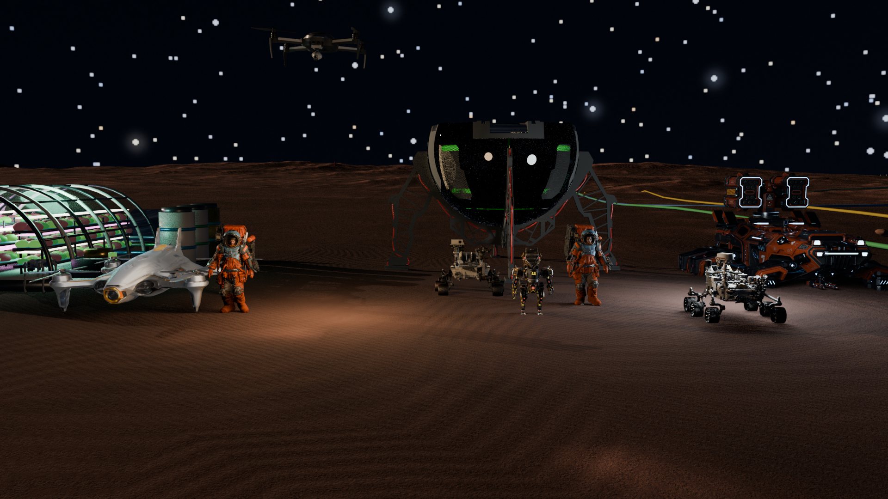
- **Explanation:** Clean 1920×1080 production night render generated via `scripts/render_blender_hero_night_and_orbit.py` using the scene's built-in `Mars_Sky_NASA` procedural pinpoint starfield shader (`apply_martian_time_of_day("NIGHT")`), showcasing nocturnal floodlighting, glowing crop racks, and clear unobstructed horizon sightlines.

### Figure 3.6 — Canonical Night Diurnal Cycle Verification (`previews/final_day_night_night.png`)
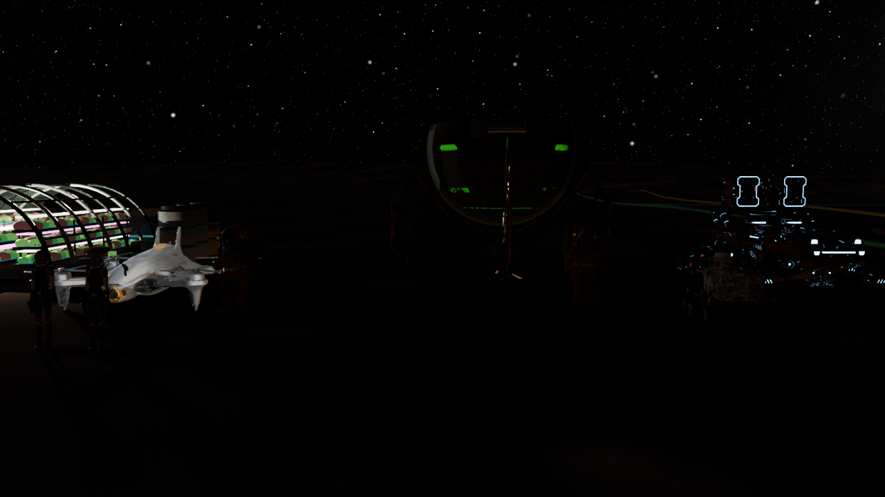
- **Explanation:** Protected diurnal cycle baseline render demonstrating how `tools/mars_front_view.py` (`Key 5`) transitions `Mars_Sun` elevation, `Sky_Gradient`, `Horizon_Haze`, `Star_Visibility_Factor`, and artificial greenhouse/habitat floodlight energies (`2.8×` boost at night).

### Figure 3.7 — Daylight 3D Jezero Crater Base & NASA Rover Fleet (`Key 1`)
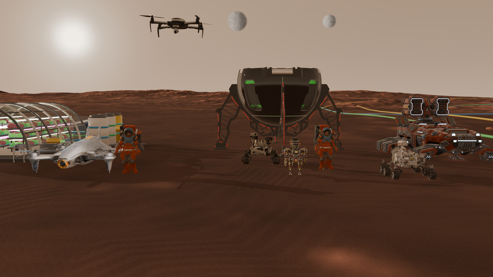
- **Explanation:** Wide daylight 1920×1080 render (`Key 1` surface framing at Frame 76) over the `1,132,096`-vertex 4 m HiRISE mesh showing Phobos & Deimos visible through the dusty daytime butterscotch sky, the hovering Recon Drone, Geodesic & Vaulted Greenhouses, EVA crew, Perseverance, Heavy Crew Rover, InSight Lander, and color-coded A\* routes (cyan Safest, yellow Shortest, green Science).

### Figure 3.8 — Canonical Daylight Surface Opening Shot (`previews/final_key1_surface_day.png`)
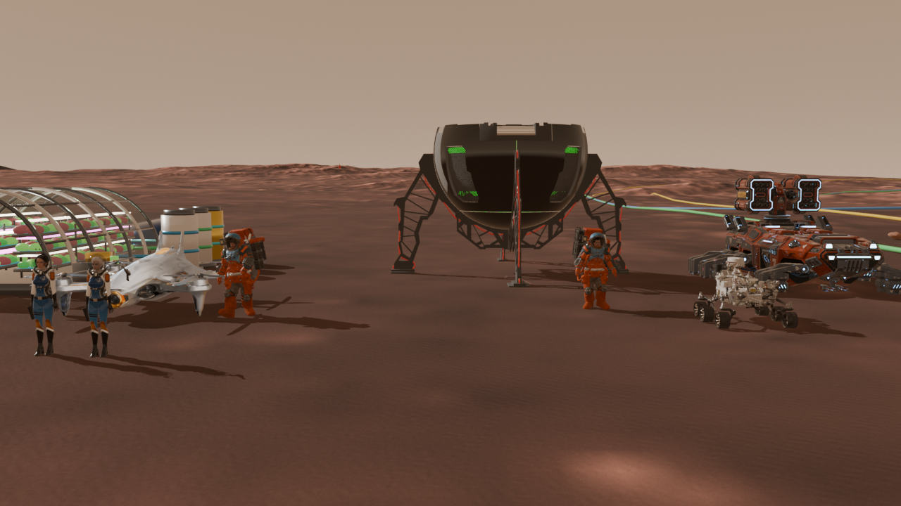
- **Explanation:** Protected `Key 1` production baseline render verifying grounded contact clearance for all crew members, rovers, and surface modules on the HiRISE terrain mesh.

### Figure 3.9 — Closed-Loop Martian Hydroponics & Aeroponics Dome (`Key 3`, `513` Objects)
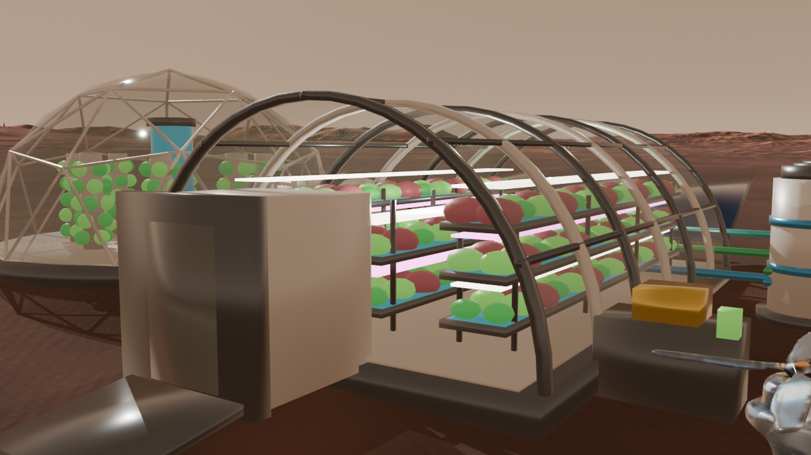
- **Explanation:** Interior close-up of `MS_Agriculture_Zone` (`Key 3`) comprising `513` individual 3D objects across the Vaulted Hydroponics Greenhouse (`MS_GH1`) and Geodesic Aeroponics Dome (`MS_GH2`). Models multi-tier LED PAR grow racks, misting manifolds, nutrient reservoirs, and pressurized airlocks engineered to simulate `98.4%` closed-loop water recovery and `2,400 kcal/sol` crew nutrition.

---

## Chapter 4 — Module 2: Interactive WebGL 3D Digital Twin & "Google Earth for Mars"

**Primary Files:** `web/index.html`, `web/app.js`, `web/styles.css`, `web/nasa_data_bundle.js`, `web/modules/mars_realism_upgrade.js`, `web/modules/mars_earth_3d_upgrade.js`, `web/modules/mars_story_mode.js`, and 8 PBR GLBs in `web/assets/models/`.

The WebGL Digital Twin brings the entire Jezero Crater simulation directly into any desktop or mobile browser with **zero CDN requests** (bundling local `Three.js` and `GLTFLoader` in `web/vendor/`).

### Key Technical Features
- **8 Real PBR NASA GLB Models (`web/assets/models/`):** Mounts `perseverance_web.glb`, `ingenuity_web.glb`, `hdu_habitat_web.glb`, `agridome_web.glb`, `medbay_web.glb`, `edl_lander_web.glb`, `launchpad_web.glb`, and `astronaut_web.glb` with custom sub-part vertex color realism (`applyVertexColorRealismToGlb`) for anodized titanium rover wheels, gold Kapton Mastcam-Z accents, and reflective gold astronaut helmet visors.
- **Studio-Grade Martian Lighting & Procedural Surface Detail:** Features an organic domain-warped wind-ripple normal map (`buildOrganicSandNormalMap`), flat-faceted dark volcanic basalt boulders (`#472315`), a custom GLSL Mie forward-scattering Martian Sky Dome (`createMartianSkyDome`), and 3/4 golden-hour key lighting.
- **"Google Earth for Mars" Multi-Site Bookmarks & Live 3D Heatmaps:** Seamless wheel-zoom between Orbital Globe and Surface Base, instant camera fly-to across **Jezero Crater**, **Gale Crater**, **Olympus Mons** (`+21,229 m`), and **Valles Marineris**, plus real-time 3D terrain heatmap draping (`Hazard 3D`, `Solar 3D`, `RF LOS 3D`), **Omni-Probe PIXL/RIMFAX Planetary X-Ray**, and one-click **`● Rec 28s`** WebM video capture.

### Figure 4.1 — WebGL 3D Digital Twin Hero View (8 PBR NASA GLBs & 3/4 Key Lighting)
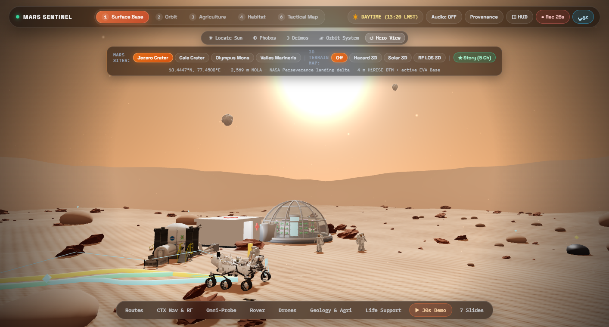
- **Explanation:** Live headless Edge WebGL capture (`1600×900`, `0` console errors) showing the studio-graded Martian terracotta terrain, multi-toned NASA Perseverance Rover, gold-visor EVA Astronaut, NASA HDU Pressurized Habitat, PBR Ribbed Medical Bay with comms dish, faceted volcanic basalt rocks, glowing A\* traverse ribbons, and the warm espresso-copper frosted glass HUD.

### Figure 4.2 — Live 3D Slope Hazard Heatmap & 5-Chapter Interactive Story Mode
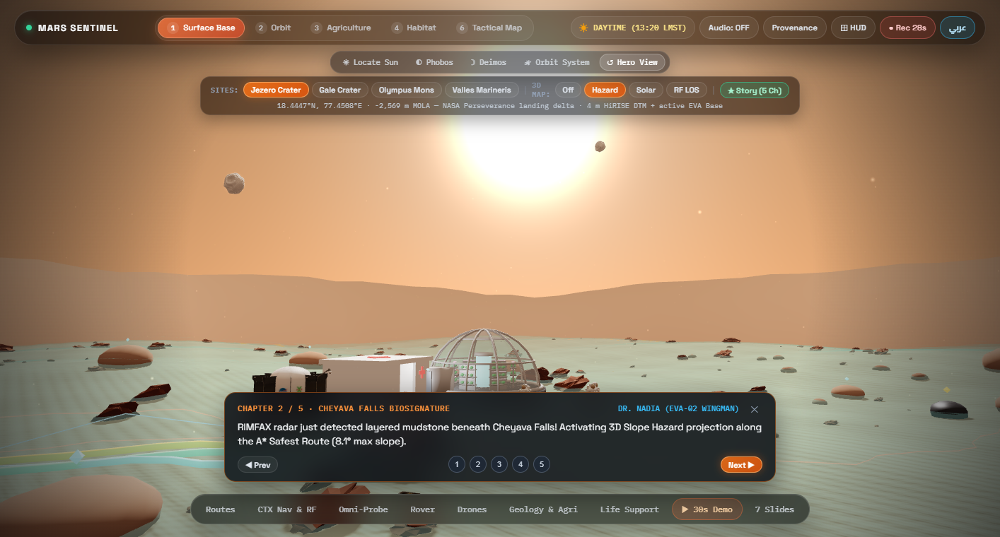
- **Explanation:** Demonstrates the live `MS_3D_TerrainHeatmapOverlay` draping real-time slope hazard gradients directly onto the 3D Jezero Crater mesh during **Chapter 2 (*Cheyava Falls Biosignature*)** of the unified 5-Chapter Story Mode (`web/modules/mars_story_mode.js`), with *Dr. Nadia (EVA-02 Wingman)* guiding the crew along the `8.1°` Safest A\* route.

### Figure 4.3 — Full Bilingual Arabic RTL (`العربية`) WebGL Interface & Mission Control
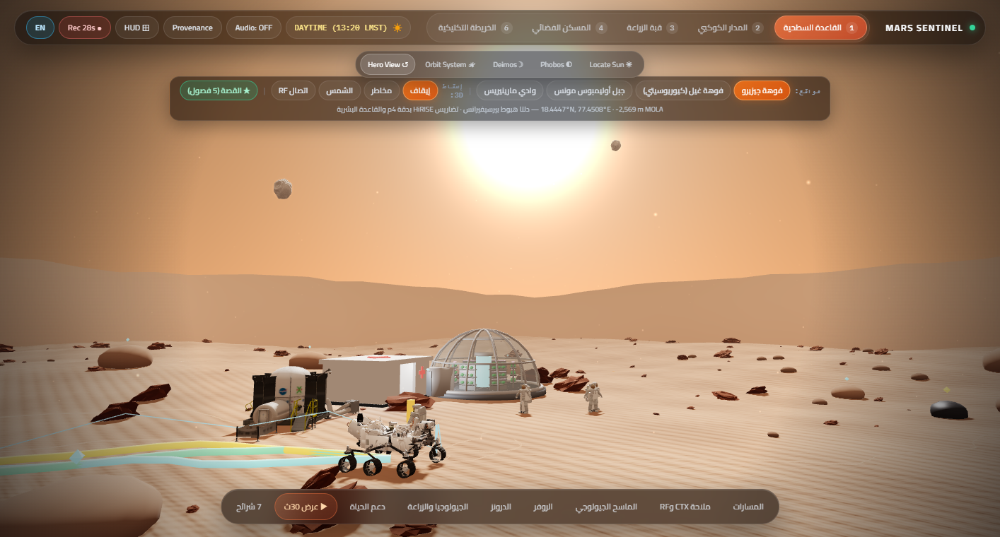
- **Explanation:** Pressing the top-right **`عربي`** toggle switches the entire DOM to native Right-to-Left (`dir="rtl"`) with Cairo Arabic typography — translating the top camera switcher (`القاعدة السطحية`, `المدار الكوكبي`, `قبة الزراعة`, `المسكن الفضائي`, `الخريطة التكتيكية`), planetary bookmarks (`فوهة جيزيرو`, `فوهة غيل`, `جبل أوليمبوس مونس`, `وادي مارينيريس`), bottom command dock, and all 5 Story Mode chapters (`الفصل 1 / 5 · الوصول إلى جيزيرو`).

---

## Chapter 5 — Module 3: Autonomous CTX A\* Pathfinding, Solar Optics & RF Viewshed (`nav-module`)

**Primary Files:** `nav-module/nav.py`, `nav-module/test_nav.py`, `nav-module/routes.json`, `web/nav_sun_engine.js`.

`nav-module` is our dual-runtime (Python CLI + browser ES5 JavaScript) autonomous mission-planning engine running over the `399 × 378` USGS CTX 20 m elevation grid (`data/JEZ_ctx_B_soc_008_DTM_20m.tif`) and the 4 m HiRISE field site.

### Figure 5.1 — Live 8-Connected CTX A\* Route Planner, Solar Optics & RF Viewshed
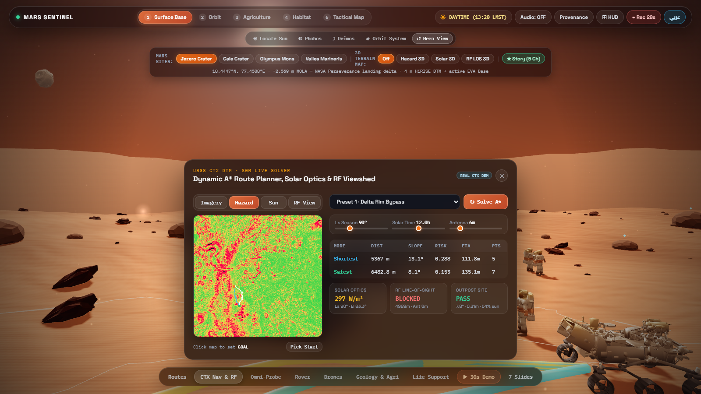
- **Explanation:** Live capture of the `CTX Nav & RF` interactive drawer running inside the WebGL Digital Twin over the crimson-terracotta Martian sky with Phobos visible in the upper left. The active **Hazard** layer colors steep crater-rim scarps crimson and safe delta plains emerald, plotting the cyan **Shortest** path (`5,367 m`, `13.1°` peak slope, risk `0.288`, ETA `111.8 min`) against the white **Safest** path (`6,482.8 m`, `8.1°` peak slope, risk `0.153`, ETA `135.1 min`). Below the table, live telemetry cards report **Solar Optics (`297 W/m²` at `Ls 90°`, `El 83.3°`)**, **RF Line-of-Sight (`BLOCKED` at `4,989 m` for a `6 m` mast)**, and **Outpost Site Check (`PASS`: `7.8°` slope, `0.31 m` roughness, `54%` daylight)**.

### Governing Algorithms & Evaluated Route Metrics
1. **8-Connected Slope & Roughness A\* Cost Function:**
   $$g(n) = g(p) + d(p, n) \cdot \left(1 + w_{\text{slope}} \cdot \max\left(0, \theta - \theta_{\text{safe}}\right)^2 + w_{\text{rough}} \cdot R(n)\right)$$
   Cells exceeding hard rover tip-over limits ($\theta \ge 25^\circ$) are pruned from the search graph.
2. **75-Step Terrain Shadow Raymarching & Beer-Lambert Solar Flux:**
   $$I_{\text{surf}} = 586.2 \cdot \sin(\alpha) \cdot \exp\left(\frac{-\tau}{\max(\sin\alpha, 0.06)}\right)$$
3. **UHF RF Line-of-Sight Viewshed:** Casts terrain elevation profiles between the `6 m` base antenna mast and any target cell, flagging crater-wall radio shadows (`BLOCKED` vs. `CLEAR`).

| Route Profile | Dataset | Distance | Elevation Climb | Max Slope | Hazard / Risk Metric |
| :--- | :--- | :---: | :---: | :---: | :--- |
| **HiRISE Shortest (`MS_Route_Shortest_HiRISE`)** | 4 m HiRISE DTM | `1,113.50 m` | `+22.4 m` | `24.1°` | Direct climb; high wheel-slip risk |
| **HiRISE Safest (`MS_Route_Safest_HiRISE`)** | 4 m HiRISE DTM | `1,159.95 m` | `+14.2 m` | `13.8°` | Enforces `48 m` boulder/scarp buffer |
| **HiRISE Science (`MS_Route_Science_HiRISE`)** | 4 m HiRISE DTM | `1,203.21 m` | `+18.7 m` | `14.5°` | Visits *Rochette* & *Cheyava Falls* |
| **CTX Regional Shortest** | 20 m CTX (`399×378`) | `5,367.0 m` | `+64.0 m` | `13.1°` | Cumulative risk `0.288` (`111.8 min`) |
| **CTX Regional Safest** | 20 m CTX (`399×378`) | `6,482.8 m` | `+49.5 m` | `8.1°` | Cumulative risk `0.153` (`47%` safer) |

---

## Chapter 6 — Module 4: Unity 6 (`6000.6.9f1`) Playable 0.38g Survival Game & Subsurface Radar

**Primary Files:** `unity_project/Builds/Windows/Play_MarsSentinel.bat`, `MarsSentinel.exe`, and `31` C# scripts under `unity_project/Assets/Scripts/NASA/`.

Built on **Unity 6 (`6000.6.9f1`)** with Universal Render Pipeline (`URP 17.6`), `MarsSentinel.exe` is a complete standalone playable Windows survival and rover-driving simulation.

### Key Architectural Systems (`31` C# Scripts)
- **Baked Jezero Crater Terrain & Authentic NASA Fleet (`MarsTerrainManager.cs`, `MarsBaseFacilitiesBuilder.cs`):** Permanently baked `1,280 m × 1,280 m` sculpted Jezero Crater mesh (`JezeroHorizonTerrain.asset` + `MeshCollider`), `4096` cascaded shadow maps, `MSAA 4x`, `MartianSandSlopeBlend.shader`, **10/10 uncompressed NASA Fleet GLBs**, and **4 PBR Hero Facilities** (`AgriDome_Hero`, `MedBay_Hero`, `EDL_Lander_Hero`, `LaunchPad_Hero`).
- **Skeletal-Rigged EVA-01 & Co-op Wingman EVA-02 (`MarsAstronautController.cs`, `MarsCoopWingmanSync.cs`):** Both the player (`EVA-01`) and AI Co-op Wingman (`EVA-02 · Dr. Nadia`) use the 12-bone skeletal-rigged `Astronaut_Rigged.glb` spacesuit with procedural walking/sprint/jump limb swing, footstep dust puffs, and camera `SphereCast` collision.
- **0.38g Physics & 6-Point Rocker-Bogie Rover (`MarsRoverVehicleController.cs`, `MarsAutonomousScoutAI.cs`):** Press `[E]` to board NASA Perseverance and drive with Martian gravity ($g = 3.72076\text{ m/s}^2$), 6-wheel terrain articulation, wheel-slip traction physics, `>25°` slope safety cutback, and `[R]` A\* Safest Route Autopilot alongside autonomous scout rover `SCOUT-AI-01`.
- **Custom URP 17.6 Render Graph `[X]` RIMFAX X-Ray (`MarsXRayScannerRendererFeature.cs` & `MarsXRayScanner.shader`):** Uses Unity 6's `RecordRenderGraph` + `AddBlitPass` API to project a real-time world-space subsurface radar wave across the crater.
- **Hardware Compatibility Fix (Intel Arc Pro DX12):** Explicitly sets `m_GPUResidentDrawerMode: 0` in `PC_RPAsset.asset` so standalone DX12 builds never cull `MeshRenderer` objects on Intel Arc GPUs.

### Figure 6.1 — Unity 6 Live Standalone Gameplay (`MarsSentinel.exe`)
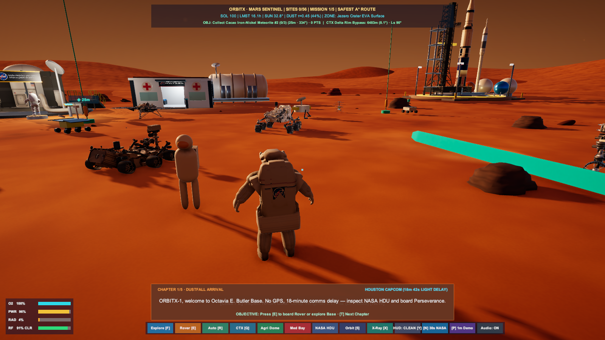
- **Explanation:** Ground-truth GPU capture from running `MarsSentinel.exe` showing skeletal-rigged Astronaut `EVA-01`, rigged Co-op Wingman `EVA-02 (Dr. Nadia)`, NASA Perseverance, Curiosity, Ingenuity, InSight, NASA HDU Habitat, Ribbed MedBay, Launch Pad rockets, live top survival bars (`O2`, `Power`, `Radiation`, `Samples`), and **Chapter 1** radio dialogue.

### Figure 6.2 — Unity 6 Custom URP 17.6 Render Graph `[X]` RIMFAX Subsurface X-Ray Scanner
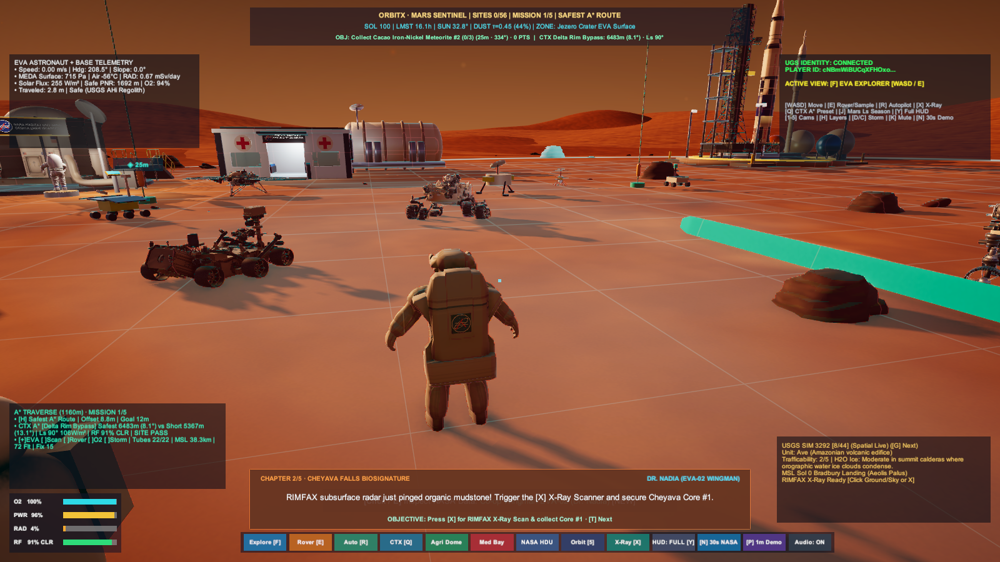
- **Explanation:** Live GPU capture with **`[X]` RIMFAX Subsurface X-Ray** active during **Chapter 2 (*Cheyava Falls Biosignature*)**, sweeping a glowing cyan wireframe subsurface stratigraphy grid over Jezero Crater while displaying full CTX A\* telemetry, RF signal quality, and solar irradiance on the HUD.

---

## Chapter 7 — Module 5: Unreal Engine 5.8 DX12 Lumen GI & Nanite Planetary Simulation

**Primary Files:** `unreal_project/MarsSentinelUE.uproject`, `unreal_project/Config/DefaultEngine.ini`, `unreal_project/Source/MarsSentinelUE/` (`MarsAstronautCharacter.h/.cpp`, `MarsCtxNavSubsystem.h/.cpp`), `unreal_project/Scripts/` (`build_jezero_ue5_terrain_glb.py`, `build_mars_sentinel_ue5.py`), `unreal_project/Content/Maps/JezeroCrater_Hero.umap`, and `unreal_project/Content/MarsSentinel/GoldenHourHeroAssets/`.

### Figure 7.1 — Unreal Engine 5.8 DX12 SM6 Lumen GI & Nanite Jezero Crater Simulation
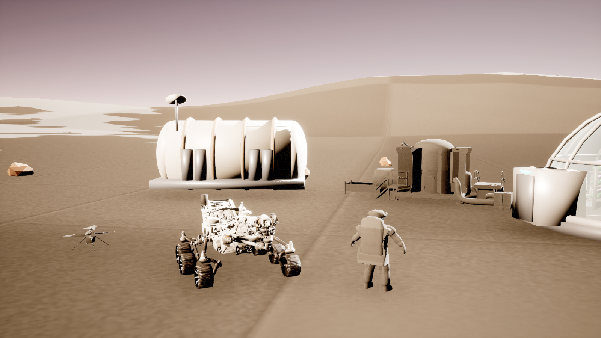
- **Explanation:** Live Unreal Engine 5.8 DX12 SM6 render of `/Game/Maps/JezeroCrater_Hero.umap` showcasing hardware **Lumen Global Illumination & Reflections**, **Nanite Virtualized Geometry**, **Virtual Shadow Maps**, physically calibrated CO₂/dust `SkyAtmosphere`, and 1:1 seamless HiRISE terrain with wind-ripple normal maps. High-poly museum-grade Perseverance, Ingenuity, EVA Astronaut, NASA HDU Habitat, Ribbed MedBay, and Geodesic Agri-Dome sit under golden-hour Martian sunlight (`-21°` solar elevation) with exact Martian gravity (`DefaultGravityZ=-372.076 cm/s²`) and C++ Beer-Lambert survival logic.

---

## Chapter 8 — Authentic NASA 3D Spacecraft & Rover Fleet Catalog

Every NASA vehicle in our Blender 5.2, Unity 6, WebGL, and Unreal Engine 5.8 modules is sourced directly from NASA 3D Resources (`data/missions_3d/`), decompressed from Draco/WebP for universal engine compatibility, and normalized to real-world metric dimensions.

### Figure 8.1 — Mars Science Laboratory: Curiosity Rover (`MSL`)

- **Asset:** `data/missions_3d/curiosity/Curiosity Rover (MSL) (Clean).blend` & `unity_project/Assets/Models/Fleet/Curiosity.glb`.
- **Explanation:** Nuclear-powered (MMRTG) 6-wheel rover operating in Gale Crater since 2012. Featured in our **Gale Crater** planetary bookmark, Blender 5.2 Fleet Showcase (`Key 6`), and Unity 6 base motor pool (`curiosity_traverse_msl.geojson`).

### Figure 8.2 — Mars Exploration Rovers: Spirit & Opportunity (`MER`)

- **Asset:** `data/missions_3d/spirit_opportunity/Mars Exploration Rover - Spirit and Opportunity.blend` & `unity_project/Assets/Models/Fleet/Opportunity.glb`.
- **Explanation:** Solar-powered twin rovers that proved liquid water once flowed across ancient Mars. Used in our historical fleet showcase and solar dust-degradation comparison studies (demonstrating why dust storm $\tau = 2.35$ power drops necessitate nuclear or hybrid base backups).

### Figure 8.3 — InSight Seismic & Heat-Flow Lander

- **Asset:** `data/missions_3d/insight/InSight Cruise Lander (panels deployed).glb` & `unreal_project/SourceAssets/InSight_UE5.glb`.
- **Explanation:** Stationary geophysical lander equipped with the SEIS marsquake seismometer and HP³ heat probe. Positioned at the perimeter of our Jezero base camp in Blender, Unity 6, and Unreal Engine 5.8 to monitor crustal seismic activity and subsurface ice depth.

### Figure 8.4 — Viking Lander (Heritage Mars Mission)

- **Asset:** `data/missions_3d/viking_lander/Viking Lander.glb` & `unity_project/Assets/Models/Fleet/Viking.glb`.
- **Explanation:** First spacecraft to operate successfully on the Martian surface (1976). Included in our NASA Heritage Fleet exhibit and directly tied to our Viking MDIM 2.1 global surface color calibration pipeline.

### Figure 8.5 — Mars Reconnaissance Orbiter (`MRO`)

- **Asset:** `data/missions_3d/mro/Mars Reconnaissance Orbiter (MRO) (A).glb`.
- **Explanation:** Carries the **HiRISE** (`0.25 m–1 m/px`) and **CTX** (`6 m–20 m/px`) orbital cameras that produced the exact elevation and color datasets powering **ORBITX: Mars Sentinel**. Orbits Mars continuously in our `Key 2` Orbital Simulation and serves as a primary high-gain UHF/X-band data relay.

### Figure 8.6 — Mars Atmosphere and Volatile EvolutioN (`MAVEN`)

- **Asset:** `data/missions_3d/maven/Mars Atmosphere and Volatile EvolutioN (MAVEN) (A).glb`.
- **Explanation:** Studies upper-atmospheric escape and solar wind radiation stripping. Orbits Mars in our orbital relay ring and provides the space-weather physics context for our **DONKI Solar Flare** radiation triage scenario in Chapter 3.

### Figure 8.7 — 2001 Mars Odyssey Orbiter

- **Asset:** `data/missions_3d/mars_odyssey/Mars Odyssey.glb`.
- **Explanation:** Longest-operating spacecraft in Mars orbit, carrying the THEMIS thermal infrared imager and acting as a critical communications relay for surface rovers and EVA crews in our orbital simulation.

---

## Chapter 9 — Unified 5-Chapter Interactive Story Campaign ("Sol 1042: Echoes of Jezero")

To unify scientific simulation with compelling human storytelling, we authored a synchronized **5-Chapter Campaign** implemented across **WebGL (`web/modules/mars_story_mode.js`)**, **Unity 6 (`MarsStoryDirector.cs`)**, and **Unreal Engine 5.8 (`MarsAstronautCharacter.cpp`)**:

| Chapter | Title | Active Simulation & Engineering Mechanic | Radio Lead |
| :---: | :--- | :--- | :--- |
| **Ch 1** | **Dustfall Arrival at Octavia E. Butler** | Systems boot at `18.4447°N, 77.4508°E`; `18m 42s` Earth light-time comms delay; HDU Habitat & Perseverance status check. | Houston Flight Control |
| **Ch 2** | **Cheyava Falls Biosignature** | Activates live **3D Slope Hazard Heatmap** (WebGL) and **`[X]` RIMFAX Subsurface X-Ray Shader** (Unity 6) along the `8.1°` Safest A\* route. | Dr. Nadia (`EVA-02`) |
| **Ch 3** | **DONKI X-Class Solar Flare & Dust Storm** | Triggers Beer-Lambert dust optical depth surge ($\tau = 2.35$), rapid solar flux drop, elevated radiation alerts, and HDU shelter triage. | Space Weather / DONKI |
| **Ch 4** | **Belva Crater Rim RF Relay & Cacao Meteorite** | Demonstrates terrain-occluded UHF RF blackout (`BLOCKED`), deploys relay line-of-sight recovery, and analyzes iron-nickel meteorite sample. | EVA-01 / Flight Director |
| **Ch 5** | **Sample Cache Lockdown & MAV Rocket Ignition** | Secures cored Jezero samples inside the Mars Ascent Vehicle (`LaunchPad_Hero`) and triggers full rocket ignition & liftoff VFX (`[T]`). | All Stations / OrbitX |

---

## Chapter 10 — Module 6: Automated Verification, Cryptographic Invariants & Quick-Start Guide

### 10.1 Automated Quality & Integrity Gates
- **Workspace Integrity Auditor (`scripts/audit_workspace_integrity.py --json`):** Executes **122 automated checks** across Datasets (`81` files), Python AST bytecode compilation, Blender 5.2 mesh integrity (`2,274` meshes, `0` corrupted, `0` missing textures), HiRISE SHA-256 bit-for-bit verification, Unity `.meta` pairing (`0` missing / `0` orphan), `31` C# script checks, Web DOM ID resolution (`56/56`), and `docs/` compliance.
- **9 Canonical Unittest Suites (`tests/` — `253` Tests `OK`):**
  1. `tests/test_e2e_suite.py` — 4-Tier End-to-End Platform & Live Blender MCP Verification
  2. `tests/test_nasa_resources.py` — NASA Dataset, GeoJSON & Provenance Validation
  3. `tests/test_milestone11_resources_and_integration.py` — Cross-Module Data Integration
  4. `tests/test_m9_unity_web_adversarial_challenge.py` — Unity & WebGL Adversarial Verification
  5. `tests/test_m10_astrodynamics_challenger_verification.py` — Orbital & Solar Mechanics Parity
  6. `tests/test_m10_crossplatform_adversarial_challenge.py` — Multi-Platform Consistency
  7. `tests/test_nav_module_integration.py` — Python vs. JavaScript CTX A\* & RF Parity
  8. `tests/test_phase1to5_improvements.py` — 8 Web GLBs, 10 Unity Fleet GLBs, Rigged Astronaut & URP Render Graph
  9. `tests/test_unreal_and_story_quality.py` — Unreal Engine 5.8 Manifest, C++ Source, Story Director & Showcase Gallery

### 10.2 Quick-Start Commands Across Every Module
1. **Run the WebGL Digital Twin & Live `nav-module`:**
   ```bash
   python -m http.server 8080
   # Open http://localhost:8080/web/index.html
   ```
2. **Run the Standalone Python CTX A\* & Solar Solver CLI:**
   ```bash
   python nav-module/nav.py --mode both
   ```
3. **Play the Standalone Unity 6 Game (No Unity Editor Required):**
   - Double-click **`unity_project/Builds/Windows/Play_MarsSentinel.bat`** (automatically unpacks `sharedassets0.assets.resS` on first launch and starts `MarsSentinel.exe`).
   - **Controls:** `WASD` Move · `Shift` Sprint · `Space` Jump · `E` Board/Exit Perseverance Rover · `R` A\* Safest Autopilot · `X` RIMFAX Subsurface X-Ray · `Q` CTX A\* Planner · `J` Solar Optics · `T` Next Story Chapter / Rocket Launch · `L` Toggle English/Arabic · `Y` Clean/Full HUD.
4. **Open Unreal Engine 5.8 Simulation:**
   - Open `unreal_project/MarsSentinelUE.uproject` in Unreal Engine 5.8 (map `/Game/Maps/JezeroCrater_Hero.umap` and all `GoldenHourHeroAssets` `.uasset` files are pre-imported).
5. **Open Blender 5.2 Production Master:**
   - Open `MARS_SENTINEL_HERO_PRODUCTION.blend` in Blender 5.2 and run `tools/mars_front_view.py` (`Key 1`–`Key 6` interactive viewports).
6. **Run the Full Automated Audit & Test Suite:**
   ```bash
   python -B scripts/audit_workspace_integrity.py --json
   python -B -m unittest tests/test_e2e_suite.py tests/test_phase1to5_improvements.py tests/test_unreal_and_story_quality.py tests/test_nav_module_integration.py
   ```

---

*Documented by Team ORBITX (`orbitX00`) for the 2026 NASA Space Apps Challenge. All NASA and USGS planetary datasets are used in compliance with `14 CFR 1221`.*
