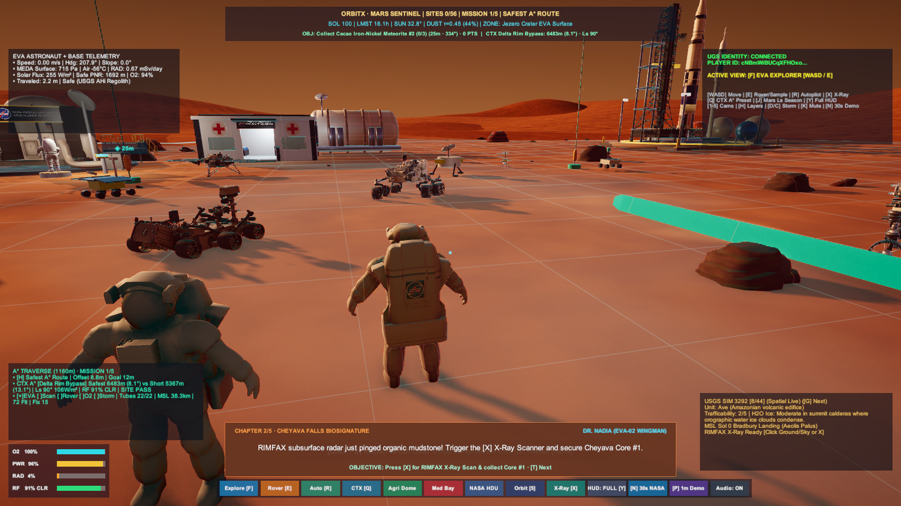
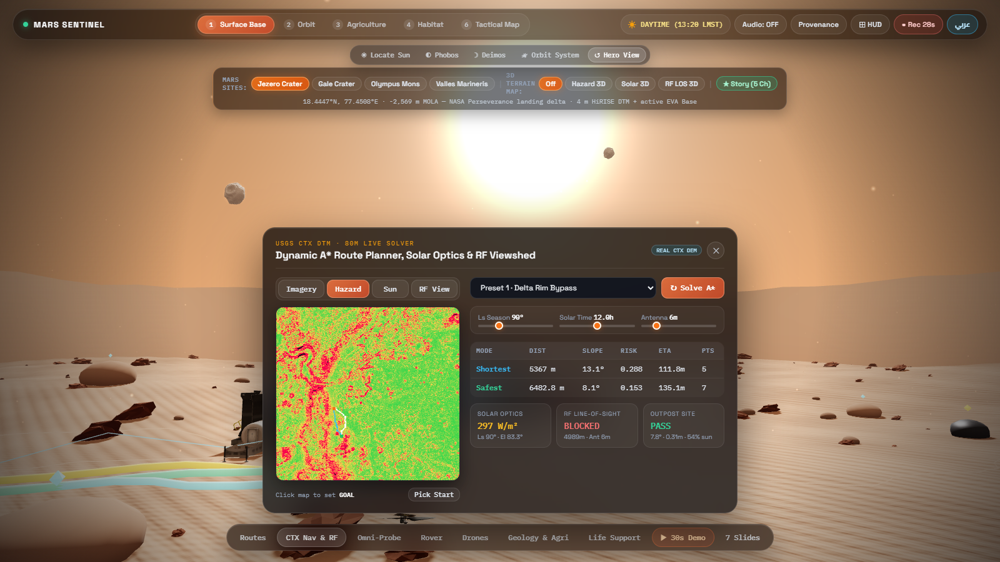
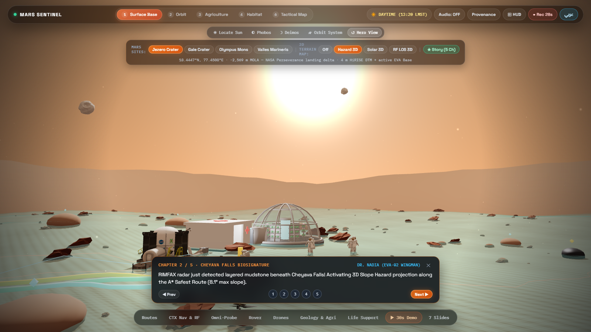

# ORBITX · MARS SENTINEL

**Multi-Engine Planetary Survival, 3D Geospatial & Autonomous EVA Platform — Toward "Google Earth for Mars"**  
*2026 NASA Space Apps Challenge · Team ORBITX (`orbitX00`) · Jezero Crater, Mars (`18.4447°N, 77.4508°E`)*

> **Multi-Module Engineering Ecosystem:** **ORBITX: Mars Sentinel** is not a single application — it is a **six-module, multi-engine planetary engineering suite** uniting a **Blender 5.2 3D Production Master** (`1,132,096`-vertex 4 m HiRISE DTM), a **Unity 6 (`6000.6.9f1`) Playable Standalone Survival Game** (`MarsSentinel.exe`), an **Unreal Engine 5.8 Lumen & Nanite Simulation** ([`unreal_project/MarsSentinelUE.uproject`](unreal_project/MarsSentinelUE.uproject)), a **Zero-CDN Three.js WebGL Digital Twin** ([`web/index.html`](web/index.html)), an **Autonomous CTX 20 m A\*, Solar & RF Viewshed Solver** ([`nav-module/nav.py`](nav-module/nav.py) & [`web/nav_sun_engine.js`](web/nav_sun_engine.js)), and a **236-Test Automated Verification Suite**.

---

## 1. Orbital & 3D Master Environment (`Blender 5.2` · `MARS_SENTINEL_HERO_PRODUCTION.blend`)

| Mars Planet & Sun from Outer Space (`Key 2`) | 3D Jezero Base & Rover Fleet — Daylight (`Key 1`) |
| :---: | :---: |
|  |  |
| **3D Martian Base at Night Under the Stars (`Key 5`)** | **Closed-Loop Hydroponics & Aeroponics Dome (`Key 3`)** |
|  |  |

- **Cryptographically Verified NASA Terrain:** Built directly on `NASA_HiRISE_DTM_Jezero_FieldSite_4m` (`1,132,096` vertices, `1,129,969` polygons, SHA-256 `ed5e2c9e0d23cb45dfbaf7c11deee3e168ea59d9681d8a094e3b514b32b354dd`) derived from USGS MRO HiRISE 1 m GeoTIFF (`data/JEZ_hirise_soc_006_DTM_1m.tif`) and calibrated with true HiRISE RGB (`data/jez_hirise_site_nasa_color_1m.png`).
- **513-Object Agriculture & Base Complex:** Features a vaulted hydroponics greenhouse (`MS_GH1`), geodesic aeroponics dome (`MS_GH2`, `98.4%` closed-loop water recovery), 4-legged spherical Habitat Pod, 39-part NASA Perseverance Rover, Curiosity MSL, Heavy Crew Vehicle, InSight Lander, Recon Drone, and 4 rigged EVA Astronauts.
- **Interactive Viewport Add-On ([`tools/mars_front_view.py`](tools/mars_front_view.py)) & MCP Bridge ([`tools/blender_mcp_server.py`](tools/blender_mcp_server.py)):** Instant camera & diurnal switching (`Key 1` Surface Base · `Key 2` Orbit Globe & Sun · `Key 3` Agriculture Zone · `Key 4` Habitat & Fleet · `Key 5` Day/Night Starfield Cycle · `Key 6` Mars Exploration Fleet).

---

## 2. Playable Standalone Survival Game (`Unity 6 — 6000.6.9f1` · `MarsSentinel.exe`)

| Live In-Game EVA, Rigged Co-op Wingman & NASA Fleet | Live URP 17.6 Render Graph `[X]` Subsurface X-Ray Scanner |
| :---: | :---: |
|  |  |

- **Authentic NASA 3D Fleet & Baked Jezero Terrain:** Ships with a baked `1,280 m × 1,280 m` sculpted Jezero Crater terrain mesh (`4096` shadow maps, `MSAA 4x`, `MartianSandSlopeBlend` shader), **10/10 uncompressed NASA Fleet GLBs** (`Perseverance`, `Ingenuity`, `Curiosity`, `Opportunity`, `InSight`, `Viking`, `MRO`, `MAVEN`, `Mars Odyssey`, `Mars Global Surveyor`), **4 PBR Hero Facilities** (`AgriDome_Hero`, `MedBay_Hero`, `EDL_Lander_Hero`, `LaunchPad_Hero`), and a skeletal-rigged **`Astronaut_Rigged.glb`** (12 bones + 4 animation clips) for both `EVA-01` and Co-op Wingman `EVA-02 (Dr. Nadia)`.
- **0.38g Physics, 6-Point Rocker-Bogie Rover & Autonomous AI:** Drive Perseverance with 6-wheel terrain suspension, hill-climb gravity drag ($g = 3.72076\text{ m/s}^2$), `>25°` slope safety cutback, and `[R]` A\* Safest Route Autopilot alongside autonomous rover `SCOUT-AI-01` (`MarsAutonomousScoutAI.cs`).
- **Custom URP 17.6 Render Graph `[X]` X-Ray & 5-Chapter Story Campaign:** `MarsXRayScannerRendererFeature.cs` projects a live world-space RIMFAX subsurface radar wave across the crater. `MarsStoryDirector.cs` drives the 5-chapter *"Sol 1042: Echoes of Jezero"* campaign culminating in a full Mars Ascent Vehicle rocket ignition & liftoff VFX sequence (`[T]`).

---

## 3. Next-Gen Lumen & Nanite Simulation (`Unreal Engine 5.8` · [`unreal_project/`](unreal_project/README.md))

- **Unreal Engine 5.8 Native Architecture ([`unreal_project/MarsSentinelUE.uproject`](unreal_project/MarsSentinelUE.uproject)):** Configured with DirectX 12 SM6 **Lumen Global Illumination & Reflections**, **Nanite Virtualized Geometry**, **Virtual Shadow Maps**, physically calibrated CO₂/dust `SkyAtmosphere`, volumetric dust fog, and exact Martian gravity (`DefaultGravityZ=-372.076 cm/s²` in [`unreal_project/Config/DefaultEngine.ini`](unreal_project/Config/DefaultEngine.ini)).
- **C++ Gameplay & Automated Interchange Pipeline:** Includes C++ 0.38g EVA character & Beer-Lambert survival logic ([`MarsAstronautCharacter.cpp`](unreal_project/Source/MarsSentinelUE/MarsAstronautCharacter.cpp)), CTX A\* route loader ([`MarsCtxNavSubsystem.cpp`](unreal_project/Source/MarsSentinelUE/MarsCtxNavSubsystem.cpp)), and automated Blender 5.2 → UE 5.8 builders ([`build_jezero_ue5_terrain_glb.py`](unreal_project/Scripts/build_jezero_ue5_terrain_glb.py) & [`build_mars_sentinel_ue5.py`](unreal_project/Scripts/build_mars_sentinel_ue5.py)) generating `/Game/Maps/JezeroCrater_Hero.umap`.

---

## 4. Autonomous CTX A\* Navigation, Solar Optics & RF Viewshed (`nav-module/`)

| `nav-module` — Live 8-Connected CTX A\*, Solar & RF Planner | Live 3D Slope Hazard Heatmap & 5-Chapter Story Comms |
| :---: | :---: |
|  |  |

- **8-Connected A\* Pathfinding Over 399×378 USGS CTX DTM ([`nav-module/nav.py`](nav-module/nav.py) & [`web/nav_sun_engine.js`](web/nav_sun_engine.js)):** Computes optimal traverses across `data/JEZ_ctx_B_soc_008_DTM_20m.tif`, contrasting **Shortest (`5,367 m`, `13.1°` peak slope, risk `0.288`)** vs. **Safest (`6,482.8 m`, `8.1°` peak slope, risk `0.153`)** with click-to-solve custom waypoints.
- **Mars Orbital Solar Raymarching & Beer-Lambert Dust Physics:** Evaluates seasonal areocentric solar longitude ($L_s \in [0^\circ, 355^\circ]$), 75-step terrain shadow raymarching, surface irradiance $I = 586.2 \cdot \exp(-\tau / \sin\alpha)$, terrain-occluded UHF RF line-of-sight viewsheds, and automated Outpost Site Checks (`Slope ≤ 10°`, `Roughness ≤ 2 m`, `Daylight ≥ 50%`).

---

## 5. Interactive WebGL Digital Twin & Bilingual EN/AR Platform ([`web/index.html`](web/index.html))

| Close-Up WebGL Digital Twin with Real NASA GLB Models | Full Bilingual Arabic RTL (`العربية`) Interface & Story |
| :---: | :---: |
|  |  |

- **Zero-CDN Offline-First 3D Web Engine:** Bundles local Three.js + `GLTFLoader` (`web/vendor/`) and 5 optimized NASA GLBs (`web/assets/models/`, `2.89 MB`), modular upgrades (`web/modules/mars_realism_upgrade.js`, `web/modules/mars_earth_3d_upgrade.js`, `web/modules/mars_story_mode.js`), **Omni-Probe PIXL/RIMFAX Planetary X-Ray**, **Multi-Site Mars Bookmarks** (`Jezero`, `Gale`, `Olympus Mons`, `Valles Marineris`), **EN/AR RTL localization**, and one-click **`● Rec 28s`** WebM video capture.

---

## 6. Multi-Module Architecture, Story Campaign & Verification

| Module | Primary Entrypoint | Core Capabilities |Verification Status |
| :--- | :--- | :--- | :--- |
| **1. Blender 5.2 Master** | `MARS_SENTINEL_HERO_PRODUCTION.blend` | `1,132,096`-vert 4 m HiRISE DTM, 513 agri objects, Orbit + Night + Day renders | SHA-256 & 2,274 meshes `PASS` |
| **2. Unity 6 Game** | `unity_project/` (`MarsSentinel.exe`) | 0.38g EVA + Rover, 10 Fleet GLBs, URP Render Graph `[X]` X-Ray, 5-Ch Story | Win64 + WebGL `ExitCode 0` |
| **3. Unreal Engine 5.8** | [`unreal_project/MarsSentinelUE.uproject`](unreal_project/MarsSentinelUE.uproject) | DX12 SM6 Lumen GI, Nanite, `-372.076 cm/s²` gravity, C++ & Python builder | `10/10` Nanite assets `PASS` |
| **4. `nav-module` Solver** | [`nav-module/nav.py`](nav-module/nav.py) · [`web/nav_sun_engine.js`](web/nav_sun_engine.js) | 399×378 CTX A\*, Mars $L_s$ shadow raymarch, RF LOS viewshed & Site Check | Empirical parity `PASS` |
| **5. WebGL Digital Twin** | [`web/index.html`](web/index.html) · [`web/app.js`](web/app.js) | Zero-CDN NASA GLBs, 3D Hazard/Solar/RF maps, Omni-Probe, EN/AR RTL, WebM | Headless CDP `0 errors` |
| **6. Audit & Test Suite** | [`scripts/audit_workspace_integrity.py`](scripts/audit_workspace_integrity.py) | 9 automated `unittest` suites + 7-slide deck ([`presentation/ORBITX_Deck.pdf`](presentation/ORBITX_Deck.pdf)) | **`121/121` Audit · `236` Tests `OK`** |

- **5-Chapter Story (*"Sol 1042: Echoes of Jezero"*):** **Ch 1** *Dustfall Arrival* → **Ch 2** *Cheyava Falls Biosignature (`[X]` RIMFAX Scan)* → **Ch 3** *DONKI Solar Flare & $\tau=2.4$ Storm Triage* → **Ch 4** *Belva Rim RF Relay & Cacao Meteorite* → **Ch 5** *Mars Ascent Vehicle Rocket Ignition*.
- **Documentation & Baselines:** [`docs/SYSTEM_GUIDE.md`](docs/SYSTEM_GUIDE.md) · [`docs/AGENTS.md`](docs/AGENTS.md) · [`unreal_project/README.md`](unreal_project/README.md) · [`presentation/Mars_Sentinel_OrbitX00.pptx`](presentation/Mars_Sentinel_OrbitX00.pptx). Protected baselines: `archive/Mars_backup_before_quality_pass.blend`, `data/JEZ_hirise_soc_006_DTM_1m.tif`, `data/JEZ_ctx_B_soc_008_DTM_20m.tif`. Public NASA/USGS datasets under `14 CFR 1221`.
