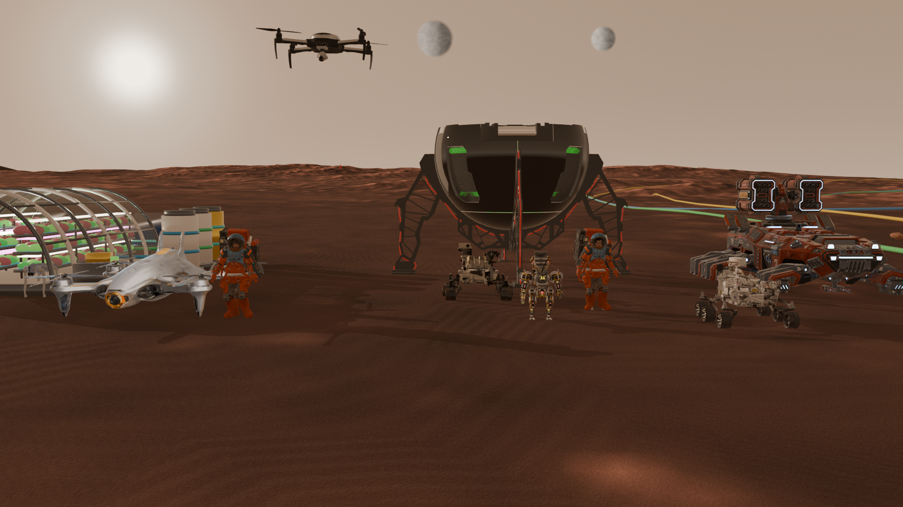
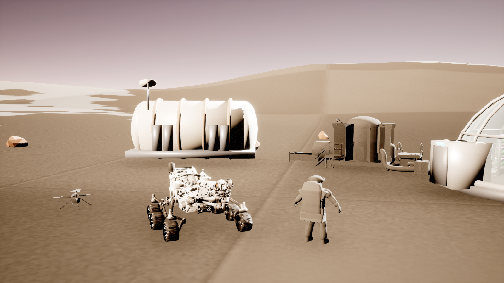

# ORBITX · MARS SENTINEL

**Multi-Engine Martian Survival, Astrodynamics, Autonomous A* Navigation and 3D Geospatial Simulation — Toward "Google Earth for Mars"**  
*2026 NASA Space Apps Challenge · Team ORBITX (orbitX00) · Octavia E. Butler Landing Site, Jezero Crater, Mars (18.4447°N, 77.4508°E)*

*Figure 1 — **Blender 5.2 Production Master (`MARS_SENTINEL_HERO_PRODUCTION.blend`)**: 3D Jezero Crater base at night under the Martian starfield featuring the 4-legged NASA Habitat Pod, glowing Geodesic Hydroponics Dome, Perseverance, Curiosity, Crew Rover, EVA Astronauts, and illuminated A* traverses.*

> **Executive Summary for Judges:** Surviving on Mars is not a single-discipline problem — it requires **simultaneously simulating orbital astrodynamics, real 1-meter planetary topography, autonomous hazard-avoiding rover pathfinding, solar dust attenuation, terrain-occluded radio communications, closed-loop hydroponic life support, and 0.38g human-rover EVA operations**. Instead of building a static map or a single prototype, **Team ORBITX** engineered an integrated **six-module simulation ecosystem** spanning **Blender 5.2**, **WebGL Three.js**, **Python and JavaScript (`nav-module`)**, **Unity 6 (`6000.6.9f1`)**, and **Unreal Engine 5.8 (Lumen & Nanite)** — all locked to the exact same cryptographically verified NASA HiRISE and USGS CTX Digital Terrain Models of Jezero Crater.

---

## 1. Visual Simulation Gallery Across All 6 Modules

Every image below is a **live, ground-truth capture** from inside its respective simulation engine, ordered from outer-space orbital mechanics down to surface EVA operations.

|  |  |
| :---: | :---: |
| **Figure 2 — Live Blender 5.2 Night Surface & Dual-Moon Simulation (Phobos & Deimos)** Direct 3D viewport simulation of nocturnal EVA operations showing Phobos and Deimos in the starry sky, hovering Recon Drone, Geodesic and Vaulted Greenhouses, Heavy Crew Rover, Perseverance, and EVA crew. | **Figure 3 — Live Blender 5.2 Outer-Space Mars, Orbital Rings & Sun Simulation** Interactive 3D astrodynamics viewport simulating Planet Mars, its inclined satellite and moon trajectories (Phobos, Deimos, MRO, MAVEN, Odyssey), and the Sun against the Milky Way. |
|  |  |
| **Figure 4 — Rendered Outer-Space Mars & Solar Astrodynamics (Key 2)** 1920x1080 orbital render of Mars, its atmospheric Rayleigh and Mie limb, natural moons, and solar illumination vector. | **Figure 5 — Blender 5.2 Daylight Jezero Crater Base & NASA Fleet (Key 1)** Daylight surface simulation over the 1,132,096-vertex 4m HiRISE DTM showing the 4-legged Spherical Habitat Pod, Hydroponics Dome, Perseverance, Curiosity, and EVA crew. |
|  |  |
| **Figure 6 — WebGL 3D Digital Twin ([`web/index.html`](web/index.html)) — 8 PBR NASA GLBs & 3/4 Key Lighting** Zero-CDN browser simulator featuring multi-toned Perseverance Rover, gold-visor EVA Astronaut, NASA HDU Habitat, PBR Ribbed Medical Bay, faceted basalt boulders, and wind-rippled terracotta sand. | **Figure 7 — `nav-module` Live 8-Connected CTX A* Pathfinding, Solar & RF Viewshed Solver** Real-time 20m USGS CTX planner comparing Shortest (5367m, 13.1° slope) vs Safest (6482.8m, 8.1° slope) routes with 297 W/m² solar irradiance and UHF RF line-of-sight analysis. |
|  |  |
| **Figure 8 — Interactive 5-Chapter Story Mode & Live 3D Slope Hazard Projection** Real-time 3D terrain heatmap draping slope hazards directly over Jezero Crater during Chapter 2 (Cheyava Falls Biosignature). | **Figure 9 — Full Bilingual Arabic RTL (العربية) WebGL Simulation & Mission Control** Native Right-to-Left Arabic interface, planetary bookmarks (فوهة جيزيرو, جبل أوليمبوس مونس, وادي مارينيريس), and Arabic Story Comms. |
|  |  |
| **Figure 10 — Unity 6 (6000.6.9f1) Playable Standalone Survival Game (`MarsSentinel.exe`)** Live 0.38g EVA gameplay with skeletal-rigged Astronaut EVA-01, Co-op Wingman EVA-02 (Dr. Nadia), drivable 6-wheel Rocker-Bogie Perseverance Rover, and live O2, Power, and Radiation HUD. | **Figure 11 — Unity 6 Custom URP 17.6 Render Graph [X] RIMFAX Subsurface X-Ray Scanner** Live GPU shader pass projecting a world-space subsurface radar wave to detect buried water-ice aquifers and mudstone strata. |
|  |  |
| **Figure 12 — Unreal Engine 5.8 ([`unreal_project/`](unreal_project/README.md)) DX12 SM6 Lumen GI & Nanite Simulation** Museum-grade high-poly Perseverance, Ingenuity, NASA HDU, Ribbed MedBay, and Geodesic Agri-Dome under physically calibrated Martian CO2 and dust SkyAtmosphere. | **Figure 13 — Closed-Loop Martian Hydroponics & Aeroponics Simulation (Key 3, 513 Objects)** Pressurized bioregenerative agriculture complex (MS_GH1 and MS_GH2) simulating 98.4% water recovery and 2400 kcal/sol crew nutrition. |

---

## 2. What We Simulated — Core Physics & Multi-Domain Engineering Models

To make **ORBITX: Mars Sentinel** a true operational decision-support platform rather than a static visual mockup, we implemented **five coupled physical simulations**:

### 2.1 Astrodynamics, Diurnal Lighting & Dual-Moon Sky Simulation
- **Outer-Space & Surface Celestial Mechanics:** Simulates Mars in orbit with its 25.19° axial tilt, seasonal areocentric solar longitude ($L_s$ from 0° to 355°), inner moon **Phobos** (9376 km semi-major axis with Stickney Crater geometry), outer moon **Deimos** (23463 km), and active NASA relay orbiters (MRO, MAVEN, Mars Odyssey, Mars Global Surveyor).
- **75-Step Terrain Shadow Raymarching & Beer-Lambert Optical Depth:** Computes true solar elevation and azimuth across the crater rim, attenuating top-of-atmosphere solar flux (586.2 W/m²) through atmospheric dust optical depth $\tau$ to model realistic solar array power generation from clear skies down to severe global dust storms.

### 2.2 Authentic 1.13-Million-Vertex NASA HiRISE & USGS CTX Topography
- **Cryptographically Locked 4m HiRISE Mesh:** Our master terrain mesh `NASA_HiRISE_DTM_Jezero_FieldSite_4m` inside `MARS_SENTINEL_HERO_PRODUCTION.blend` contains **1,132,096 vertices and 1,129,969 polygons** (SHA256 `ed5e2c9e0d23cb45dfbaf7c11deee3e168ea59d9681d8a094e3b514b32b354dd`), sampled directly from USGS MRO HiRISE 1m GeoTIFF `data/JEZ_hirise_soc_006_DTM_1m.tif` and textured with calibrated HiRISE RGB `data/jez_hirise_site_nasa_color_1m.png`.
- **Regional 20m CTX Basin Grid:** Coupled with `data/JEZ_ctx_B_soc_008_DTM_20m.tif` (399x378 elevation grid covering Neretva Vallis and the western delta scarp) for long-range rover traverse planning.

### 2.3 Autonomous Slope-Penalized A* Pathfinding & UHF RF Line-of-Sight (`nav-module`)
- **Multi-Policy 8-Connected A* Solver (`nav-module/nav.py` & `web/nav_sun_engine.js`):** Evaluates step distance, slope angle, and local 3x3 terrain roughness to compute contrasting mission profiles:
  - **HiRISE 4m Base Traverses:** **Shortest (1,113.50 m**, 24.1° max slope), **Safest (1,159.95 m**, 13.8° max slope, 48m hazard buffer), and **Science (1,203.21 m** via Rochette and Cheyava Falls outcrops).
  - **CTX 20m Regional Traverses:** Live click-to-solve **Shortest (5367 m, 13.1° slope, risk 0.288)** vs **Safest (6482.8 m, 8.1° slope, risk 0.153)**.
- **Terrain-Occluded RF Viewshed & Outpost Site Check:** Ray-casts radio line-of-sight between the 6m base transmitter mast and moving EVA units, flagging crater-wall radio blackouts (BLOCKED vs CLEAR) and grading candidate landing sites (Slope <= 10°, Roughness <= 2m, Daylight >= 50%).

### 2.4 0.38g EVA Survival, 6-Point Rocker-Bogie Rover Physics & RIMFAX Radar
- **Martian Gravity & Suspension Physics:** Simulates 3.72076 m/s² (0.38g), 6-wheel independent Rocker-Bogie terrain articulation, wheel-slip traction loss on steep regolith, >25° automatic slope safety cutback, and [R] A* Safest Autopilot alongside autonomous scout rover SCOUT-AI-01.
- **Closed-Loop Life Support & Bioregenerative Agriculture:** Models real-time EVA Suit O2, battery reserve, radiation dose (with NASA DONKI solar flare alerts and dust storm power drops), shelter recharge inside the NASA HDU Habitat, and 98.4% water recycling inside the 513-object Hydroponics and Aeroponics Dome.

---

## 3. Deep Dive Into the 6 Synchronized Project Modules

| Module & Engine | Primary Files & Entrypoints | Key Engineering Highlights | Verification |
| :--- | :--- | :--- | :--- |
| **1. Blender 5.2 Master** | `MARS_SENTINEL_HERO_PRODUCTION.blend` [`tools/mars_front_view.py`](tools/mars_front_view.py) `tools/blender_mcp_server.py` | 1,132,096-vert HiRISE DTM, 513 agri objects, 10 NASA spacecraft, viewport hotkeys (Key 1 Surface, Key 2 Orbit, Key 3 Agriculture, Key 4 Habitat, Key 5 Day/Night, Key 6 Fleet) and live TCP MCP bridge (:9876). | 2274 meshes & SHA256 PASS |
| **2. WebGL Digital Twin** | [`web/index.html`](web/index.html) `web/app.js` `web/modules/mars_earth_3d_upgrade.js` | Zero-CDN local Three.js + 8 PBR NASA GLBs, 3D Hazard/Solar/RF terrain heatmaps, Omni-Probe X-Ray, Multi-Site Bookmarks (Jezero, Gale, Olympus Mons, Valles Marineris), EN/AR RTL, Rec 28s WebM. | Headless CDP 0 errors |
| **3. `nav-module` Solver** | `nav-module/nav.py` `web/nav_sun_engine.js` | Standalone Python CLI + live browser ES5 engine running 8-connected A* over 399x378 CTX DTM, 75-step solar shadow raymarching, RF viewshed & Outpost Site Check. | Python & JS parity PASS |
| **4. Unity 6 Survival Game** | `unity_project/` (`MarsSentinel.exe`) `MarsStoryDirector.cs` | Playable Win64 + WebGL game on baked 1280m Jezero mesh, 10 Fleet GLBs, 4 PBR Facilities, skeletal-rigged EVA-01 & Co-op Wingman EVA-02, URP 17.6 Render Graph [X] X-Ray, 5-Ch Story & Rocket Launch. | Win64 & WebGL ExitCode 0 |
| **5. Unreal Engine 5.8** | `unreal_project/MarsSentinelUE.uproject` `build_mars_sentinel_ue5.py` | DX12 SM6 Lumen GI, Nanite, Virtual Shadow Maps, -372.076 cm/s² gravity, C++ EVA character & CTX subsystem, automated Blender to UE 5.8 pipeline (`JezeroCrater_Hero.umap`). | 10/10 Nanite assets PASS |
| **6. Audit & Test Suite** | `scripts/audit_workspace_integrity.py` `presentation/ORBITX_Deck.pdf` | 122-check workspace integrity auditor + 9 automated unittest suites (253 tests) verifying cryptographic hashes, GLB binary headers, C#/C++/JS AST, and 7-slide judge deck. | **122/122 Audit · 253 Tests OK** |

---

## 4. Unified 5-Chapter Story Campaign & Quick-Start Guide

- **5-Chapter Story ("Sol 1042: Echoes of Jezero" across WebGL, Unity 6 & Unreal 5.8):** **Ch 1** Octavia E. Butler Landing & Systems Boot → **Ch 2** Cheyava Falls Biosignature & [X] RIMFAX Subsurface Scan → **Ch 3** DONKI X-Class Solar Flare & Dust Storm Shelter Triage → **Ch 4** Belva Crater Rim RF Relay Deployment & Cacao Meteorite Analysis → **Ch 5** Sample Cache Lockdown & Mars Ascent Vehicle Rocket Ignition ([T]).
- **Run Any Module Instantly:**
  - **WebGL Digital Twin & `nav-module`:** `python -m http.server 8080` then open `http://localhost:8080/web/index.html` (or run `python nav-module/nav.py --mode both`).
  - **Unity 6 Standalone Game:** Launch `unity_project/Builds/Windows/MarsSentinel.exe` (WASD move, E board Perseverance, R A* Autopilot, X RIMFAX X-Ray, Q CTX A*, T Next Story Chapter / Rocket Launch, L EN/AR).
  - **Unreal Engine 5.8 & Blender 5.2:** Open `unreal_project/MarsSentinelUE.uproject` in UE 5.8, or open `MARS_SENTINEL_HERO_PRODUCTION.blend` in Blender 5.2 with [`tools/mars_front_view.py`](tools/mars_front_view.py).
- **Canonical Documentation:** [`docs/SYSTEM_GUIDE.md`](docs/SYSTEM_GUIDE.md) · [`docs/AGENTS.md`](docs/AGENTS.md) · [`unreal_project/README.md`](unreal_project/README.md) · `presentation/ORBITX_Deck.pdf` · `presentation/Mars_Sentinel_OrbitX00.pptx`. Protected NASA/USGS baselines (`archive/Mars_backup_before_quality_pass.blend`, `data/JEZ_hirise_soc_006_DTM_1m.tif`, `data/JEZ_ctx_B_soc_008_DTM_20m.tif`) comply with 14 CFR 1221.
