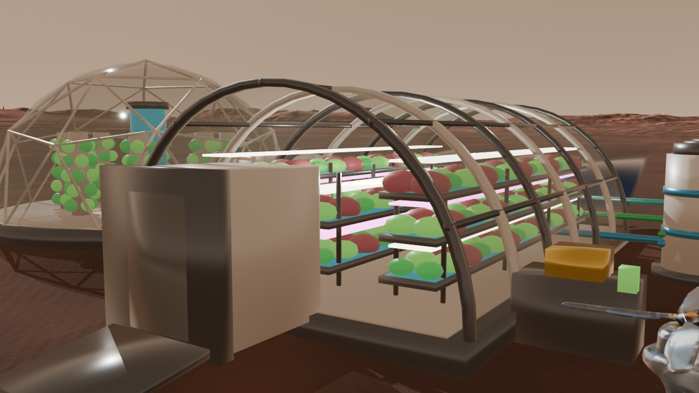
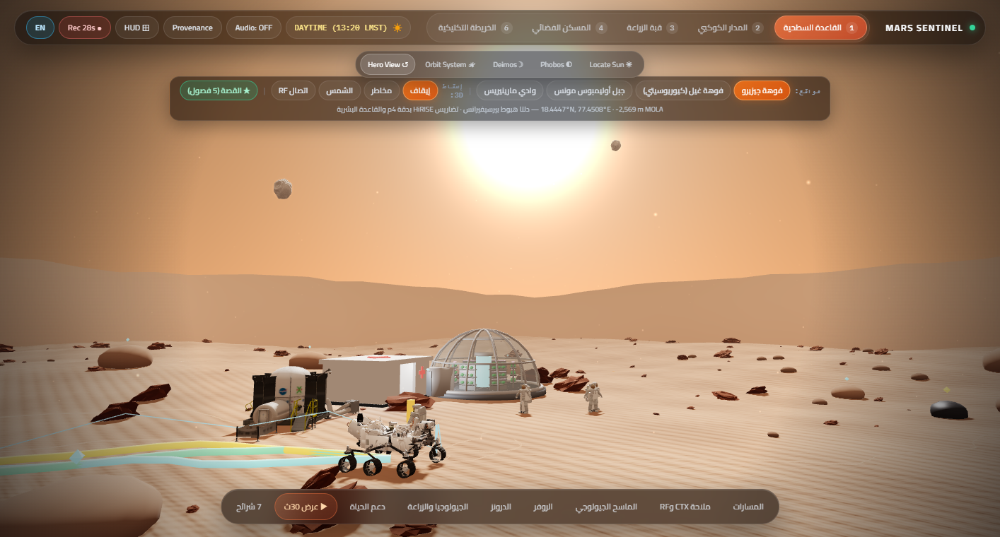

<p align="center">
  <br />
  <em><strong>"Hope you read to the end"</strong></em>
</p>

<h1 align="center">ORBITX · MARS SENTINEL</h1>

<p align="center">
  <strong>Multi-Engine Martian Survival, Astrodynamics, Autonomous A* Navigation & 3D Geospatial Simulation — Toward "Google Earth for Mars"</strong><br />
  <em>2026 NASA Space Apps Challenge · Team ORBITX (<code>orbitX00</code>) · Octavia E. Butler Landing Site, Jezero Crater, Mars (<code>18.4447°N, 77.4508°E</code>)</em>
</p>

<p align="center">
  <a href="#1-system-architecture--what-we-simulated">Architecture & Simulations</a> •
  <a href="#2-outer-space-astrodynamics--mars-sun-orbital-simulation-blender-52">Orbital Simulation</a> •
  <a href="#3-nocturnal-daylight--bioregenerative-3d-surface-simulation-blender-52">3D Surface & Agriculture</a> •
  <a href="#4-interactive-webgl-3d-digital-twin--bilingual-enar-platform-web">WebGL Digital Twin</a> •
  <a href="#5-autonomous-ctx-a-pathfinding-solar-optics--rf-viewshed-nav-module">CTX A* & RF Solver</a> •
  <a href="#6-playable-038g-survival-game--subsurface-radar-unity-6">Unity 6 Game</a> •
  <a href="#7-next-gen-lumen-gi--nanite-planetary-simulation-unreal-engine-58">Unreal Engine 5.8</a> •
  <a href="#8-repository-structure-quick-start--verification">Quick-Start</a>
</p>

---

## Executive Summary

Surviving on Mars is not a single-discipline challenge. Real mission operations require **simultaneously simulating orbital astrodynamics, meter-scale crater topography, autonomous hazard-avoiding rover pathfinding, atmospheric dust solar attenuation, terrain-occluded radio communications, closed-loop hydroponic agriculture, and 0.38g human-rover EVA mechanics**.

Instead of building a static map or a single-purpose prototype, **Team ORBITX** engineered an integrated **six-module simulation ecosystem** spanning **Blender 5.2**, **WebGL (Three.js)**, **Python & JavaScript (`nav-module`)**, **Unity 6 (`6000.6.9f1`)**, and **Unreal Engine 5.8 (Lumen & Nanite)**. Every module operates on the exact same cryptographically verified NASA HiRISE (`4 m/px`) and USGS CTX (`20 m/px`) Digital Terrain Models of Jezero Crater.

---

## 1. System Architecture & What We Simulated

| # | Module & Engine | Primary Entrypoints | What We Simulated | Verification Status |
| :---: | :--- | :--- | :--- | :--- |
| **1** | **Blender 5.2 3D Master** | `MARS_SENTINEL_HERO_PRODUCTION.blend`<br>[`tools/mars_front_view.py`](tools/mars_front_view.py) | Outer-space Mars + Sun + 6 orbital rings (`Phobos`, `Deimos`, `MRO`, `MAVEN`, `Odyssey`, `MGS`), `1,132,096`-vertex 4 m HiRISE DTM, nocturnal dual-moon sky, and 513-object hydroponics complex. | `2,274` meshes & SHA-256 `PASS` |
| **2** | **WebGL 3D Digital Twin** | [`web/index.html`](web/index.html)<br>`web/app.js` · `web/modules/` | Zero-CDN browser simulation with 8 PBR NASA GLB models, live 3D Terrain Heatmaps (`Hazard 3D`, `Solar 3D`, `RF LOS 3D`), Omni-Probe X-Ray, Multi-Site Bookmarks, and English/Arabic RTL UI. | Headless Edge CDP `0 errors` |
| **3** | **`nav-module` Solver** | `nav-module/nav.py`<br>`web/nav_sun_engine.js` | 8-connected slope- and roughness-penalized A* pathfinding over the `399 × 378` USGS CTX DEM, 75-step terrain shadow raymarching, Beer-Lambert solar irradiance, and UHF RF line-of-sight viewshed. | Python & JS parity `PASS` |
| **4** | **Unity 6 Survival Game** | `unity_project/`<br>`MarsSentinel.exe` | Playable `0.38g` EVA & 6-wheel Rocker-Bogie Perseverance driving on a baked `1,280 m` Jezero mesh, rigged Astronaut `EVA-01` & Co-op Wingman `EVA-02`, URP 17.6 Render Graph `[X]` RIMFAX radar, and 5-Chapter Story. | Win64 & WebGL `ExitCode 0` |
| **5** | **Unreal Engine 5.8** | [`unreal_project/`](unreal_project/README.md)<br>`MarsSentinelUE.uproject` | DirectX 12 SM6 **Lumen Global Illumination**, **Nanite Virtualized Geometry**, `-372.076 cm/s²` Martian gravity, C++ EVA survival & CTX subsystem, and automated Blender-to-UE5 level builder. | `10/10` Nanite assets `PASS` |
| **6** | **Verification Suite** | `scripts/audit_workspace_integrity.py`<br>`presentation/ORBITX_Deck.pdf` | 122-check workspace integrity auditor + 9 automated `unittest` suites (`253` tests) verifying dataset hashes, GLB binary headers, C#/C++/JS AST, and the 7-slide judge presentation deck. | **`122/122` Audit · `253` Tests `OK`** |

---

## 2. Outer-Space Astrodynamics & Mars–Sun Orbital Simulation (`Blender 5.2`)


*Figure 1 — **Live Blender 5.2 Outer-Space Astrodynamics Simulation (`Key 2`)**: Interactive 3D orbital viewport simulating Planet Mars, its inclined satellite and moon trajectories (`Phobos`, `Deimos`, `MRO`, `MAVEN`, `Mars Odyssey`), and the Sun against the Milky Way starfield.*

### What We Simulated in Orbital Space
- **3D Keplerian Orbits & Relay Constellation:** Models Mars with its `25.19°` axial obliquity, seasonal areocentric solar longitude ($L_s \in [0^\circ, 355^\circ]$), inner moon **Phobos** (`9,376 km` semi-major axis with Stickney Crater geometry), outer moon **Deimos** (`23,463 km`), and active NASA relay orbiters (`MRO`, `MAVEN`, `Mars Odyssey`, `Mars Global Surveyor`).
- **Coupled Orbital-to-Surface Illumination:** The solar vector computed in orbital space directly drives surface solar elevation $\alpha$, crater-rim shadow raymarching, and Beer-Lambert atmospheric dust attenuation across all surface modules.

---

## 3. Nocturnal, Daylight & Bioregenerative 3D Surface Simulation (`Blender 5.2`)


*Figure 2 — **Live Blender 5.2 Nocturnal Surface & Dual-Moon Simulation (`Key 5`)**: Nighttime EVA operations at Jezero Crater showing both Martian moons (`Phobos` & `Deimos`) glowing in the starry sky above the western delta rim, hovering Recon Drone, illuminated Geodesic & Vaulted Hydroponics Greenhouses, Heavy Crew Rover, Perseverance, and glowing A\* routes.*

| Daylight 4 m HiRISE Base & NASA Rover Fleet (`Key 1`) | Closed-Loop Hydroponics & Aeroponics Dome (`Key 3`) |
| :---: | :---: |
|  |  |
| **Figure 3A — Daylight Jezero Base Over 1.13M-Vertex HiRISE DTM**<br>*Daylight surface simulation featuring the Geodesic & Vaulted Greenhouses, Recon Drones, EVA Crew, Perseverance, Crew Rover, and InSight Lander.* | **Figure 3B — Bioregenerative Hydroponics & Aeroponics Dome (`513` Objects)**<br>*Internal simulation of pressurized crop racks (`MS_GH1` & `MS_GH2`) achieving `98.4%` water recovery and `2,400 kcal/sol` crew nutrition.* |

### What We Simulated on the Martian Surface
- **Cryptographically Locked 1.13-Million-Vertex NASA HiRISE Mesh:** `NASA_HiRISE_DTM_Jezero_FieldSite_4m` inside `MARS_SENTINEL_HERO_PRODUCTION.blend` contains **`1,132,096` vertices and `1,129,969` polygons** (SHA-256 `ed5e2c9e0d23cb45dfbaf7c11deee3e168ea59d9681d8a094e3b514b32b354dd`), sampled directly from USGS MRO HiRISE 1 m GeoTIFF `data/JEZ_hirise_soc_006_DTM_1m.tif` and textured with true HiRISE RGB `data/jez_hirise_site_nasa_color_1m.png`.
- **Interactive Viewport Controls ([`tools/mars_front_view.py`](tools/mars_front_view.py)) & Live MCP Bridge (`tools/blender_mcp_server.py` on port `9876`):** Instant camera and diurnal switching across `Key 1` Surface Base · `Key 2` Orbit Globe · `Key 3` Agriculture Zone · `Key 4` Habitat & Fleet · `Key 5` Day/Night Starfield Cycle · `Key 6` Mars Exploration Fleet.

---

## 4. Interactive WebGL 3D Digital Twin & Bilingual EN/AR Platform (`web/`)


*Figure 4A — **WebGL 3D Digital Twin ([`web/index.html`](web/index.html))**: Zero-CDN browser simulation featuring 8 real PBR NASA GLB models (multi-toned Perseverance Rover with anodized titanium wheels & gold Mastcam-Z, gold-visor EVA Astronaut, NASA HDU Habitat, PBR Ribbed Medical Bay, Geodesic Agri-Dome), faceted volcanic basalt boulders, organic wind-rippled terracotta sand, and 3/4 golden-hour lighting.*

| Live 3D Slope Hazard Heatmap & 5-Chapter Story Mode | Full Bilingual Arabic RTL (`العربية`) Mission Control |
| :---: | :---: |
|  |  |
| **Figure 4B — Live 3D Slope Hazard Projection & Story Mode**<br>*Real-time 3D heatmap draping slope hazards directly over Jezero Crater during Chapter 2 (Cheyava Falls Biosignature).* | **Figure 4C — Bilingual Arabic RTL (`العربية`) WebGL Interface**<br>*Native Right-to-Left Arabic telemetry, planetary bookmarks (`فوهة جيزيرو`, `جبل أوليمبوس مونس`, `وادي مارينيريس`), and Arabic Story Comms.* |

### What We Simulated in the WebGL Digital Twin
- **Zero-CDN Offline-First 3D Engine (`web/app.js` & `web/modules/`):** Bundles local Three.js + `GLTFLoader` and **8 real PBR NASA GLB assets** (`web/assets/models/`: `perseverance_web.glb`, `ingenuity_web.glb`, `hdu_habitat_web.glb`, `agridome_web.glb`, `medbay_web.glb`, `edl_lander_web.glb`, `launchpad_web.glb`, and `astronaut_web.glb`).
- **"Google Earth for Mars" Exploration Suite:** Features live 3D Terrain Heatmap projection (`Hazard 3D`, `Solar 3D`, `RF LOS 3D`), **Omni-Probe PIXL & RIMFAX Planetary X-Ray Scanner**, **Multi-Site Mars Bookmarks** (`Jezero Crater`, `Gale Crater`, `Olympus Mons`, `Valles Marineris`), seamless Orbit-to-Surface scroll transition, instant English/Arabic RTL switching, and one-click **`Rec 28s`** WebM video recording.

---

## 5. Autonomous CTX A\* Pathfinding, Solar Optics & RF Viewshed (`nav-module`)


*Figure 5 — **`nav-module` Live 8-Connected USGS CTX 20 m A\* Route Planner, Solar Optics & RF Viewshed Solver**: Real-time pathfinding over the `399 × 378` CTX DEM contrasting Shortest (`5,367 m`, `13.1°` peak slope) vs. Safest (`6,482.8 m`, `8.1°` peak slope) traverses alongside `297 W/m²` solar irradiance and UHF RF line-of-sight analysis.*

### What We Simulated in `nav-module` (`nav-module/nav.py` & `web/nav_sun_engine.js`)

| Route Profile | Spatial Dataset | Total Distance | Net Climb | Max Slope | Risk Index / Engineering Notes |
| :--- | :--- | :---: | :---: | :---: | :--- |
| **Shortest Route (`MS_Route_Shortest_HiRISE`)** | 4 m HiRISE DTM | `1,113.50 m` | `+22.4 m` | `24.1°` | Direct delta climb; high wheel-slip risk on steep scarp |
| **Safest Route (`MS_Route_Safest_HiRISE`)** | 4 m HiRISE DTM | `1,159.95 m` | `+14.2 m` | `13.8°` | Enforces `48 m` hazard buffer around boulder fields |
| **Science Route (`MS_Route_Science_HiRISE`)** | 4 m HiRISE DTM | `1,203.21 m` | `+18.7 m` | `14.5°` | Connects *Rochette* and *Cheyava Falls* sample outcrops |
| **CTX Regional Shortest** | 20 m CTX DEM (`399×378`) | `5,367.0 m` | `+64.0 m` | `13.1°` | Cumulative risk `0.288` across Neretva Vallis rim |
| **CTX Regional Safest** | 20 m CTX DEM (`399×378`) | `6,482.8 m` | `+49.5 m` | `8.1°` | Cumulative risk `0.153` (`47%` safer slope profile) |

- **75-Step Solar Shadow Raymarching & Beer-Lambert Dust Physics:** Evaluates seasonal solar longitude $L_s$, ray-marches terrain self-shadowing across the crater wall, and computes surface solar flux $I = 586.2 \cdot \exp(-\tau / \max(\sin\alpha, 0.06))$.
- **Terrain-Occluded UHF RF Viewshed & Outpost Site Check:** Ray-casts line-of-sight from the `6 m` base antenna to moving EVA units (`CLEAR` vs. `BLOCKED` radio dead zones) and grades candidate outpost sites (`Slope ≤ 10°`, `Roughness ≤ 2 m`, `Daylight ≥ 50%`).

---

## 6. Playable 0.38g Survival Game & Subsurface Radar (`Unity 6`)

| Live `MarsSentinel.exe` EVA, Rigged Co-op Wingman & Rover | Custom URP 17.6 Render Graph `[X]` RIMFAX Subsurface Radar |
| :---: | :---: |
|  |  |
| **Figure 6A — Unity 6 (`6000.6.9f1`) Playable Standalone Survival Game**<br>*Live `0.38g` gameplay with skeletal-rigged Astronaut `EVA-01`, Co-op Wingman `EVA-02 (Dr. Nadia)`, drivable 6-wheel Perseverance Rover, and live O2/Power/Radiation HUD.* | **Figure 6B — Custom URP 17.6 Render Graph `[X]` RIMFAX Radar Scanner**<br>*Live GPU shader pass (`MarsXRayScannerRendererFeature.cs`) projecting a 3D subsurface radar wave to detect buried water-ice aquifers and mudstone strata.* |

### What We Simulated in Unity 6 (`unity_project/`)
- **0.38g Gravity, 6-Point Rocker-Bogie Suspension & Autonomous AI:** Drive Perseverance across a baked `1,280 m × 1,280 m` Jezero Crater terrain mesh (`4096` shadows, `MSAA 4x`, 10 uncompressed NASA Fleet GLBs, 4 PBR Hero Facilities) with real wheel-slip traction physics ($g = 3.72076\text{ m/s}^2$), `>25°` slope safety cutback, and `[R]` A\* Safest Route Autopilot alongside autonomous scout rover `SCOUT-AI-01`.
- **Closed-Loop Survival & 5-Chapter Story (`MarsStoryDirector.cs`):** Simulates suit `O2`, battery power, NASA DONKI solar flare radiation alerts, dust storm $\tau = 2.35$ shelter triage, 3 collectible core samples, and the 5-chapter *"Sol 1042: Echoes of Jezero"* campaign ending in a Mars Ascent Vehicle rocket launch (`[T]`).

---

## 7. Next-Gen Lumen GI & Nanite Planetary Simulation (`Unreal Engine 5.8`)


*Figure 7 — **Unreal Engine 5.8 ([`unreal_project/`](unreal_project/README.md)) DX12 SM6 Lumen Global Illumination & Nanite Simulation**: Golden-hour Martian surface simulation over the 4 m NASA HiRISE Jezero Crater DTM featuring high-poly Perseverance Rover, Ingenuity Helicopter, EVA Astronaut, NASA HDU Habitat, Ribbed Medical Bay, and Geodesic Agri-Dome.*

### What We Simulated in Unreal Engine 5.8 (`unreal_project/MarsSentinelUE.uproject`)
- **Native DX12 SM6 Lumen & Nanite Pipeline:** Configured with **Lumen Global Illumination & Reflections**, **Nanite Virtualized Geometry**, **Virtual Shadow Maps**, physically calibrated CO2/dust `SkyAtmosphere`, and exact Martian gravity (`DefaultGravityZ=-372.076 cm/s²` in `unreal_project/Config/DefaultEngine.ini`).
- **C++ Gameplay & Automated Python Builders:** Includes C++ `0.38g` EVA character & Beer-Lambert survival logic (`MarsAstronautCharacter.cpp`), CTX A\* route subsystem (`MarsCtxNavSubsystem.cpp`), and automated Blender 5.2 → UE 5.8 Python builders (`build_jezero_ue5_terrain_glb.py` & `build_mars_sentinel_ue5.py`) generating `/Game/Maps/JezeroCrater_Hero.umap`.

---

## 8. Repository Structure, Quick-Start & Verification

```text
ORBITX-NASA-SPACE-APP/
├── MARS_SENTINEL_HERO_PRODUCTION.blend   # Blender 5.2 Master Scene (1,132,096-vert 4m HiRISE DTM)
├── web/                                  # Zero-CDN Three.js WebGL Digital Twin (8 PBR NASA GLBs, EN/AR RTL)
│   ├── index.html & app.js               # Main WebGL Simulator & UI Controller
│   ├── nav_sun_engine.js                 # Live Browser 8-Connected CTX A*, Solar & RF Viewshed Engine
│   └── modules/                          # Modular 3D Realism, Google Earth Bookmarks & 5-Ch Story Mode
├── nav-module/                           # Standalone Python CTX 20m A*, Solar & RF Solver (nav.py)
├── unity_project/                        # Unity 6 (6000.6.9f1) Playable Survival Game (MarsSentinel.exe)
├── unreal_project/                       # Unreal Engine 5.8 DX12 Lumen & Nanite Project (C++ & Python)
├── tools/                                # Blender 5.2 Viewport Operator (mars_front_view.py) & MCP Server
├── data/                                 # NASA HiRISE 1m & USGS CTX 20m GeoTIFFs, Provenance & RGB Maps
├── showcase/                             # Ground-Truth Captures Across All 6 Modules
├── presentation/                         # 7-Slide Judge Deck (ORBITX_Deck.pdf & Mars_Sentinel_OrbitX00.pptx)
├── docs/                                 # Canonical SSOT (SYSTEM_GUIDE.md) & Agent Rules (AGENTS.md)
└── tests/ & scripts/                     # 122-Check Auditor & 9 Automated Unittest Suites (253 Tests)
```

### Quick-Start Commands
1. **WebGL Digital Twin & `nav-module`:** Run `python -m http.server 8080` and open `http://localhost:8080/web/index.html` (or CLI: `python nav-module/nav.py --mode both`).
2. **Unity 6 Playable Survival Game:** Launch `unity_project/Builds/Windows/MarsSentinel.exe` (`WASD` move · `E` board Perseverance · `R` A\* Autopilot · `X` RIMFAX X-Ray · `Q` CTX A\* · `T` Story / Rocket Launch · `L` EN/AR).
3. **Unreal Engine 5.8 & Blender 5.2:** Open `unreal_project/MarsSentinelUE.uproject` in UE 5.8, or open `MARS_SENTINEL_HERO_PRODUCTION.blend` in Blender 5.2 with [`tools/mars_front_view.py`](tools/mars_front_view.py).
4. **Full Verification Suite (`122/122 Audit PASS` · `253/253 Tests OK`):** Run `python scripts/audit_workspace_integrity.py --json` and `python -m unittest discover -s tests`.

### Canonical Documentation & NASA Data Compliance
- **Documentation:** [`docs/SYSTEM_GUIDE.md`](docs/SYSTEM_GUIDE.md) · [`docs/AGENTS.md`](docs/AGENTS.md) · [`unreal_project/README.md`](unreal_project/README.md) · `presentation/ORBITX_Deck.pdf` · `presentation/Mars_Sentinel_OrbitX00.pptx`.
- **Protected Baselines:** `archive/Mars_backup_before_quality_pass.blend`, `data/JEZ_hirise_soc_006_DTM_1m.tif` (DOI `10.5066/P9REJ9JN`), and `data/JEZ_ctx_B_soc_008_DTM_20m.tif` (DOI `10.5066/P906QQT8`). All public NASA and USGS planetary datasets comply with `14 CFR 1221`.
