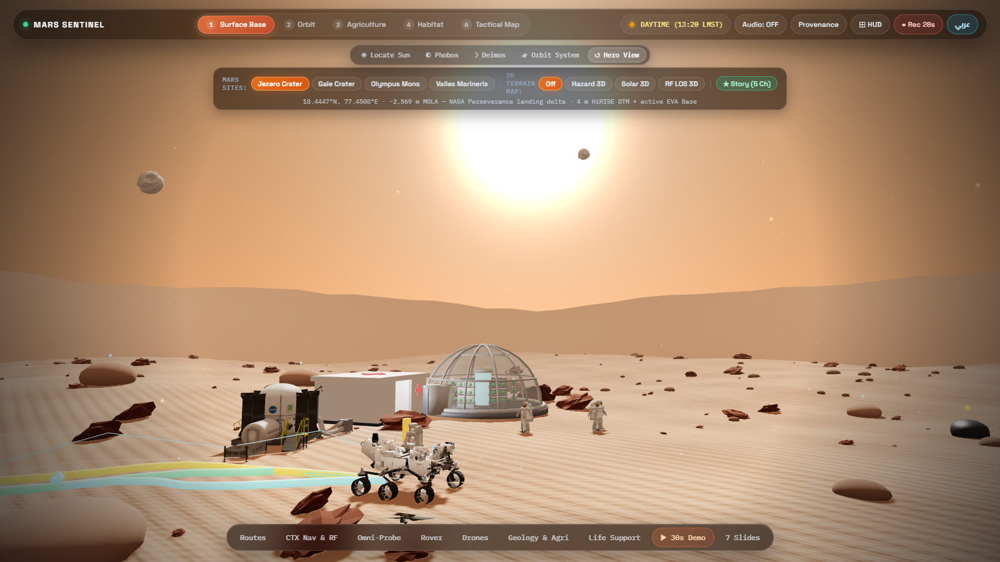
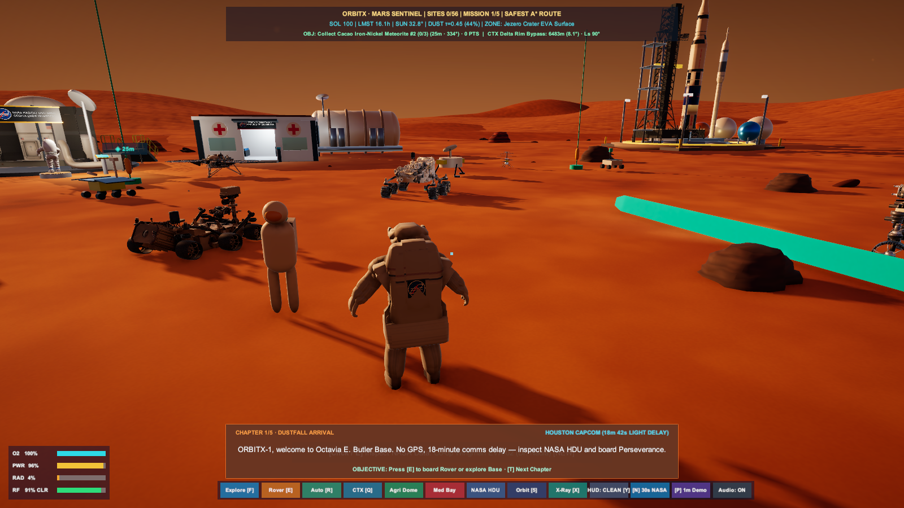
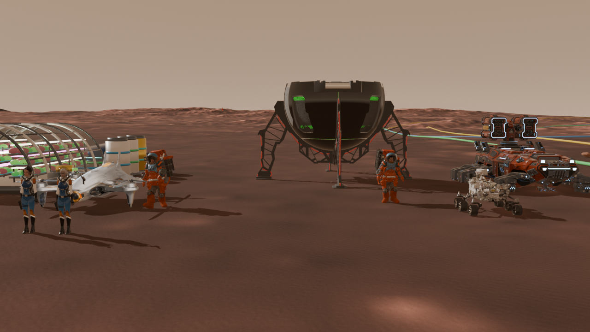

# ORBITX · MARS SENTINEL

**Interplanetary Survival Guide: Martian Map — Toward "Google Earth for Mars"**  
*NASA Space Apps Challenge 2026 · Team ORBITX (`orbitX00`) · Jezero Crater (`18.4447°N, 77.4508°E`)*

## Live In-App Module Showcase (Web + `nav-module` + Unity 6 + Unreal 5.8 + Blender 5.2)

| `nav-module` — Live CTX A\* & RF Viewshed | WebGL — Bilingual Arabic RTL & 5-Ch Story |
| :---: | :---: |
|  |  |
| **Unity 6 (`MarsSentinel.exe`) — Live Gameplay & HUD** | **Unity 6 — Live URP Render Graph `[X]` X-Ray** |
|  |  |
| **Unreal Engine 5.8 — Lumen GI & Nanite Jezero** | **Blender 5.2 — 3D Master Surface Base** |
|  |  |

## Four Synchronized Platforms & 5-Chapter Story (*"Sol 1042: Echoes of Jezero"*)

1. **Web Digital Twin ([`web/index.html`](web/index.html))** — Zero-CDN local Three.js + `GLTFLoader` mounting 5 NASA GLBs (`Perseverance`, `Ingenuity`, `HDU`, `Agri-Dome`, `Astronauts`), 3D Terrain Heatmap Projection (`Hazard / Solar / RF`), CTX A\* planner ([`web/nav_sun_engine.js`](web/nav_sun_engine.js)), Mars Bookmarks (`Jezero`, `Gale`, `Olympus Mons`, `Valles Marineris`), **Omni-Probe X-Ray**, **EN/AR RTL**, **`● Rec 28s`** WebM capture, and Story Mode ([`web/modules/mars_story_mode.js`](web/modules/mars_story_mode.js)).
2. **Playable Game — Unity 6 (`6000.6.9f1`)** — Standalone `MarsSentinel.exe` with baked 1,280 m Jezero terrain (`4096` shadows, `MSAA 4x`), 10/10 NASA Fleet GLBs, rigged `Astronaut_Rigged.glb`, 4 PBR facilities, URP Render Graph `[X]` X-Ray Scanner, Cinemachine 6.6, Glass Game Shell, **5-Chapter Story Director** (with Rocket Liftoff VFX), `SCOUT-AI-01`, `EVA-02`, spatial audio, CloudSave/Leaderboard, and EN/AR.
3. **Unreal Engine 5.8 Module ([`unreal_project/MarsSentinelUE.uproject`](unreal_project/MarsSentinelUE.uproject))** — DX12 SM6 **Lumen GI**, **Nanite**, VSM, Mars gravity `-372.076 cm/s²`, Martian `SkyAtmosphere`, C++ gameplay & CTX A\* (`Source/MarsSentinelUE/`), and UE 5.8 scene builder (`Scripts/build_mars_sentinel_ue5.py`).
4. **3D Master (Blender 5.2)** — `MARS_SENTINEL_HERO_PRODUCTION.blend` on 4 m HiRISE DTM (`1,132,096` verts).

**Story Arc (`Sol 1042`):** Ch 1 *Arrival* → Ch 2 *Cheyava X-Ray* → Ch 3 *DONKI Storm Triage* → Ch 4 *Belva RF & Cacao* → Ch 5 *Rocket Ignition*.

## Quick Links & Layout
- [`docs/SYSTEM_GUIDE.md`](docs/SYSTEM_GUIDE.md) · [`docs/AGENTS.md`](docs/AGENTS.md) · [`web/index.html`](web/index.html) · [`unreal_project/README.md`](unreal_project/README.md) · [`tools/mars_front_view.py`](tools/mars_front_view.py) · [`nav-module/nav.py`](nav-module/nav.py) · [`presentation/ORBITX_Deck.pdf`](presentation/ORBITX_Deck.pdf) · [`presentation/Mars_Sentinel_OrbitX00.pptx`](presentation/Mars_Sentinel_OrbitX00.pptx)
- **Dirs:** `web/` (`vendor/`, `modules/`, `assets/`) · `unity_project/` · `unreal_project/` · `nav-module/` · `data/` · `showcase/` · `presentation/` · `tools/` · `scripts/` · `tests/` · `docs/`.

## Hotkeys & Baselines
- **Blender (`tools/mars_front_view.py`):** `Key 1` Surface · `Key 2` Orbit · `Key 3` Agriculture · `Key 4` Habitat · `Key 5` Day/Night · `Key 6` Fleet.
- **Unity 6 & UE 5.8:** `[F]` Explore · `WASD` Move/Drive (`3.72 m/s²`) · `[E]` Rover/Core · `[R]` Autopilot · `[X]` X-Ray · `[T]` Story · `[V]` Visor · `[B]` Lamp · `[Q]` CTX A\* · `[J]` Season `Ls` · `[Y]` HUD · `[D/C]` Storm · `[Esc]` Pause/EN-AR · `[N/P]` Demos · `[K]` Mute.
- **Baselines:** `archive/Mars_backup_before_quality_pass.blend`, `data/JEZ_hirise_soc_006_DTM_1m.tif`, `data/JEZ_ctx_B_soc_008_DTM_20m.tif`. Public NASA data under `14 CFR 1221`.
