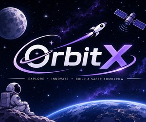
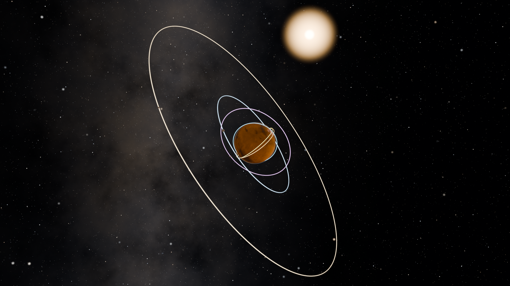
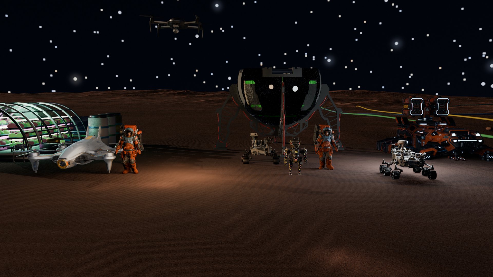

  

  # ORBITX · MARS SENTINEL

  **Multi-Engine Martian Survival, Astrodynamics, Autonomous A* Navigation & 3D Geospatial Simulation — Toward "Google Earth for Mars"**  
  *2026 NASA Space Apps Challenge · Team ORBITX (orbitX00) · Octavia E. Butler Landing Site, Jezero Crater, Mars (18.4447°N, 77.4508°E)*

> **Executive Summary for Judges:** Surviving on Mars is not a single-discipline problem — it requires **simultaneously simulating orbital astrodynamics, real 1-meter planetary topography, autonomous hazard-avoiding rover pathfinding, solar dust attenuation, terrain-occluded radio communications, closed-loop hydroponic life support, and 0.38g human-rover EVA operations**. Instead of building a static map or a single prototype, **Team ORBITX** engineered an integrated **six-module simulation ecosystem** spanning **Blender 5.2**, **WebGL Three.js**, **Python & JavaScript (`nav-module`)**, **Unity 6 (6000.6.9f1)**, and **Unreal Engine 5.8 (Lumen & Nanite)** — all locked to the exact same cryptographically verified NASA HiRISE and USGS CTX Digital Terrain Models of Jezero Crater.

---

## 1. Outer-Space Astrodynamics & Mars–Sun Orbital Simulation (`Blender 5.2` · `Key 2`)

|  |  |
| :---: | :---: |
| **Figure 1.1 — Live Blender 5.2 Outer-Space Mars, Orbital Rings & Sun Simulation** Interactive 3D astrodynamics viewport simulating Planet Mars, its inclined satellite and moon trajectories (Phobos, Deimos, MRO, MAVEN, Odyssey), and the Sun against the Milky Way. | **Figure 1.2 — 1920x1080 Rendered Outer-Space Mars & Solar Illumination (Key 2)** Production render from `MARS_SENTINEL_HERO_PRODUCTION.blend` showing Mars, its Rayleigh and Mie atmospheric limb, natural moons, and solar vector. |

- **3D Keplerian Orbital & Relay Constellation Simulation:** Simulates Mars in orbit with its 25.19° axial tilt, seasonal areocentric solar longitude ($L_s$ from 0° to 355°), inner moon **Phobos** (9376 km semi-major axis with Stickney Crater geometry), outer moon **Deimos** (23463 km), and active NASA relay orbiters (MRO, MAVEN, Mars Odyssey, Mars Global Surveyor).
- **Coupled Orbital-to-Surface Solar Vector:** The orbital sun position directly drives surface solar elevation, crater-rim shadow raymarching, and Beer-Lambert atmospheric dust attenuation across all surface modules.

---

## 2. Nocturnal, Daylight & Bioregenerative 3D Surface Simulation (`Blender 5.2` · `Key 1`, `Key 3`, `Key 5`)

|  |  |
| :---: | :---: |
| **Figure 2.1 — Live Blender 5.2 Nocturnal Surface & Dual-Moon Simulation (Phobos & Deimos)** Direct 3D viewport simulation of night EVA operations showing Phobos and Deimos in the starry sky, hovering Recon Drone, Geodesic and Vaulted Greenhouses, Heavy Crew Rover, and Perseverance. | **Figure 2.2 — Rendered 1920x1080 Nocturnal Base Under Pinpoint Starfield (Key 5)** Clean production night render using the procedural `Mars_Sky_NASA` starfield, illuminated Hydroponics Domes, EVA Astronauts, Rover fleet, and glowing A* routes. |
|  |  |
| **Figure 2.3 — Daylight 3D Jezero Crater Base & NASA Fleet Over 4m HiRISE DTM (Key 1)** Daylight surface simulation over the 1,132,096-vertex 4m HiRISE terrain showing the base camp, Perseverance, Crew Rover, Recon Drones, and EVA crew. | **Figure 2.4 — Closed-Loop Martian Hydroponics & Aeroponics Dome Simulation (Key 3, 513 Objects)** Internal simulation of pressurized crop racks (MS_GH1 and MS_GH2) achieving 98.4% water recovery and 2400 kcal/sol crew nutrition. |

- **Cryptographically Locked 1.13-Million-Vertex NASA HiRISE Mesh:** Built directly on `NASA_HiRISE_DTM_Jezero_FieldSite_4m` inside `MARS_SENTINEL_HERO_PRODUCTION.blend` (**1,132,096 vertices**, **1,129,969 polygons**, SHA256 `ed5e2c9e0d23cb45dfbaf7c11deee3e168ea59d9681d8a094e3b514b32b354dd`), sampled from USGS MRO HiRISE 1m GeoTIFF `data/JEZ_hirise_soc_006_DTM_1m.tif` and calibrated with true HiRISE RGB `data/jez_hirise_site_nasa_color_1m.png`.
- **Interactive Viewport Operator ([`tools/mars_front_view.py`](tools/mars_front_view.py)) & Live MCP Bridge (`tools/blender_mcp_server.py` on port 9876):** Instant camera and diurnal switching across `Key 1` Surface Base, `Key 2` Orbit Globe, `Key 3` Agriculture Zone, `Key 4` Habitat & Fleet, `Key 5` Day/Night Starfield Cycle, and `Key 6` Mars Exploration Fleet.

---

## 3. Autonomous CTX A* Pathfinding, Solar Optics & RF Viewshed Simulation (`nav-module`)

|  |  |
| :---: | :---: |
| **Figure 3.1 — `nav-module` Live 8-Connected CTX A* Pathfinding, Solar & RF Viewshed Solver** Real-time 20m USGS CTX planner comparing Shortest (5367m, 13.1° slope) vs Safest (6482.8m, 8.1° slope) routes with 297 W/m² solar irradiance and UHF RF line-of-sight analysis. | **Figure 3.2 — Live 3D Terrain Slope Hazard Heatmap & Chapter 2 Story Simulation** Real-time 3D heatmap draping slope hazards directly over Jezero Crater during Chapter 2 (Cheyava Falls Biosignature discovery). |

- **Multi-Policy 8-Connected A* Solver (`nav-module/nav.py` & `web/nav_sun_engine.js`):** Evaluates step distance, slope angle, and local 3x3 terrain roughness over `data/JEZ_ctx_B_soc_008_DTM_20m.tif` (399x378 grid) and the 4m HiRISE mesh:
  - **HiRISE 4m Base Traverses:** **Shortest (1,113.50 m**, 24.1° max slope), **Safest (1,159.95 m**, 13.8° max slope, 48m hazard buffer), and **Science (1,203.21 m** via Rochette and Cheyava Falls outcrops).
  - **CTX 20m Regional Traverses:** Live click-to-solve **Shortest (5367 m, 13.1° slope, risk 0.288)** vs **Safest (6482.8 m, 8.1° slope, risk 0.153)**.
- **75-Step Shadow Raymarching, UHF RF Viewshed & Outpost Site Check:** Ray-casts radio line-of-sight between the 6m base transmitter mast and moving EVA units, flagging crater-wall radio blackouts (BLOCKED vs CLEAR) and grading candidate outpost sites (Slope <= 10°, Roughness <= 2m, Daylight >= 50%).

---

## 4. Interactive WebGL 3D Digital Twin & Bilingual EN/AR Platform ([`web/index.html`](web/index.html))

|  |  |
| :---: | :---: |
| **Figure 4.1 — WebGL 3D Digital Twin (`web/index.html`) — 8 PBR NASA GLBs & 3/4 Key Lighting** Zero-CDN browser simulator featuring multi-toned Perseverance Rover, gold-visor EVA Astronaut, NASA HDU Habitat, PBR Ribbed Medical Bay, faceted basalt boulders, and wind-rippled terracotta sand. | **Figure 4.2 — Full Bilingual Arabic RTL (العربية) WebGL Simulation & Mission Control** Native Right-to-Left Arabic interface, planetary bookmarks (فوهة جيزيرو, جبل أوليمبوس مونس, وادي مارينيريس), and Arabic Story Comms. |

- **Zero-CDN Offline-First 3D Web Engine (`web/app.js` & `web/modules/`):** Bundles local Three.js + `GLTFLoader` and **8 real PBR NASA GLB models** (`web/assets/models/`: Perseverance, Ingenuity, NASA HDU Habitat, Geodesic Agri-Dome, Ribbed Medical Bay, EDL Lander, Launch Pad, and EVA Astronaut).
- **"Google Earth for Mars" Capabilities:** Includes live 3D Terrain Heatmap projection (Hazard 3D, Solar 3D, RF LOS 3D), **Omni-Probe PIXL & RIMFAX Planetary X-Ray Scanner**, **Multi-Site Mars Bookmarks** (Jezero, Gale, Olympus Mons, Valles Marineris), seamless Orbit-to-Surface zoom, English/Arabic RTL switching, and one-click **Rec 28s** WebM video capture.

---

## 5. Playable Standalone 0.38g Survival Game & Subsurface Radar (`Unity 6` · `MarsSentinel.exe`)

|  |  |
| :---: | :---: |
| **Figure 5.1 — Unity 6 (6000.6.9f1) Playable Standalone Survival Game (`MarsSentinel.exe`)** Live 0.38g EVA gameplay with skeletal-rigged Astronaut EVA-01, Co-op Wingman EVA-02 (Dr. Nadia), drivable 6-wheel Rocker-Bogie Perseverance Rover, and live O2, Power, and Radiation HUD. | **Figure 5.2 — Custom URP 17.6 Render Graph [X] RIMFAX Subsurface Radar Scanner** Live GPU shader pass (`MarsXRayScannerRendererFeature.cs`) projecting a world-space subsurface radar wave to detect buried water-ice aquifers and mudstone strata. |

- **0.38g Rover Rocker-Bogie Physics, Autonomous AI & Co-op Wingman:** Drive Perseverance across a baked 1280m sculpted Jezero terrain mesh (4096 shadows, MSAA 4x, 10 uncompressed NASA Fleet GLBs, 4 PBR Hero Facilities) with 6-wheel independent suspension, wheel-slip traction physics, >25° automatic slope safety cutback, and [R] A* Safest Route Autopilot alongside autonomous scout rover SCOUT-AI-01 and rigged Co-op Wingman EVA-02.
- **Real Survival Loop & 5-Chapter Story Campaign (`MarsStoryDirector.cs`):** Simulates suit O2, battery power, NASA DONKI solar flare radiation alerts, dust storm shelter triage, 3 collectible Jezero core samples, and the 5-chapter *"Sol 1042: Echoes of Jezero"* campaign culminating in a Mars Ascent Vehicle rocket ignition and liftoff sequence ([T]).

---

## 6. Next-Gen Lumen GI & Nanite Planetary Simulation ([`unreal_project/`](unreal_project/README.md))

*Figure 6.1 — **Unreal Engine 5.8 (`unreal_project/MarsSentinelUE.uproject`) — DX12 SM6 Lumen Global Illumination & Nanite Simulation**: Golden-hour Martian surface simulation over the 4m NASA HiRISE Jezero Crater DTM featuring high-poly Perseverance Rover, Ingenuity Helicopter, EVA Astronaut, NASA HDU Habitat, Ribbed Medical Bay, and Geodesic Agri-Dome.*

- **Native Unreal Engine 5.8 Architecture:** Configured with DirectX 12 SM6 **Lumen Global Illumination & Reflections**, **Nanite Virtualized Geometry**, **Virtual Shadow Maps**, physically calibrated CO2 and dust `SkyAtmosphere`, and exact Martian gravity (`DefaultGravityZ=-372.076 cm/s²` in `unreal_project/Config/DefaultEngine.ini`), with C++ 0.38g EVA character (`MarsAstronautCharacter.cpp`), CTX A* route subsystem (`MarsCtxNavSubsystem.cpp`), and automated Blender-to-UE5 Python builders (`build_mars_sentinel_ue5.py` generating `JezeroCrater_Hero.umap`).

---

## 7. Quick-Start & Automated Verification Scorecard (`122/122 Audit · 253 Tests OK`)

- **Quick-Start Any Module:** **WebGL & `nav-module`:** `python -m http.server 8080` then open `http://localhost:8080/web/index.html` (or `python nav-module/nav.py --mode both`) · **Unity 6 Game:** Run `unity_project/Builds/Windows/MarsSentinel.exe` (WASD move, E board rover, R A* Autopilot, X RIMFAX X-Ray, Q CTX A*, T Story / Rocket Launch, L EN/AR) · **Unreal 5.8 & Blender 5.2:** Open `unreal_project/MarsSentinelUE.uproject` or `MARS_SENTINEL_HERO_PRODUCTION.blend`.
- **Canonical Documentation & Baselines:** [`docs/SYSTEM_GUIDE.md`](docs/SYSTEM_GUIDE.md) · [`docs/AGENTS.md`](docs/AGENTS.md) · [`unreal_project/README.md`](unreal_project/README.md) · `presentation/ORBITX_Deck.pdf` · `presentation/Mars_Sentinel_OrbitX00.pptx` · `scripts/audit_workspace_integrity.py`. Protected NASA/USGS baselines (`archive/Mars_backup_before_quality_pass.blend`, `data/JEZ_hirise_soc_006_DTM_1m.tif`, `data/JEZ_ctx_B_soc_008_DTM_20m.tif`) comply with 14 CFR 1221.
